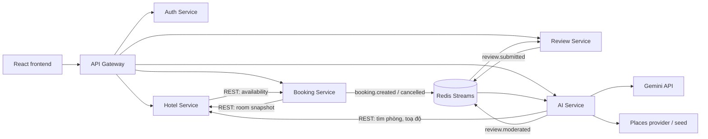

# HK1_2627_INT3505E_2_Group8 – HotelGenie

Repo Nhóm 8, học phần INT3505E 2 – Kiến trúc hướng dịch vụ, HK1 2026–2027.

> Nhánh `project` chứa bài tập lớn HotelGenie. Nhánh `main` giữ bài tập `tasks-api` làm trước khi bắt đầu project.

HotelGenie là hệ thống đặt phòng khách sạn theo kiến trúc hướng dịch vụ (SOA), có 3 tính năng AI. AI chỉ hỗ trợ: phòng, giá, tình trạng trống và địa điểm luôn lấy từ dữ liệu thật của các service.

| Tính năng AI | Endpoint |
| --- | --- |
| Tìm phòng bằng câu tiếng Việt | `POST /api/v1/ai/searches` |
| Phân tích cảm xúc và kiểm duyệt review | `POST /api/v1/reviews` → event `review.submitted` → AI → `review.moderated` |
| Gợi ý đi lại, ăn uống, giải trí gần khách sạn | `GET /api/v1/hotels/{hotel_id}/nearby-places` |

## Thành viên và vai trò

Vai trò TV1–TV5 theo `docs/07-implementation-plan.md`.

| STT | Mã sinh viên | Họ và tên | Vai trò | Phụ trách chính |
| --- | --- | --- | --- | --- |
| 1 | 21021503 | Nguyễn Phan Hùng | TV1 | Repo, Docker Compose, Gateway, CI, React, tích hợp |
| 2 | 24021485 | Lã Việt Hoàng | TV3 | Hotel Service, OpenAPI/event contracts, dữ liệu |
| 3 | 24021380 | Nguyễn Minh Ánh | TV5 | AI Service: tìm phòng, kiểm duyệt review |
| 4 | 24021599 | Bạch Mai Phương | TV2 | Auth Service, Review Service |
| 5 | 21020628 | Doãn Minh Hoàng | TV4 | Booking Service, dữ liệu địa điểm gần khách sạn |

## Kiến trúc



- 5 service Flask, mỗi service sở hữu một schema PostgreSQL riêng; không có khoá ngoại xuyên service.
- REST cho truy vấn và lệnh cần kết quả ngay; Redis Streams cho sự kiện, có outbox và consumer idempotent.
- Chống đặt trùng phòng bằng exclusion constraint PostgreSQL trong transaction; `POST /bookings` có `Idempotency-Key`.

Chi tiết: `docs/03-SAD.md`.

## Công nghệ

| Thành phần | Lựa chọn |
| --- | --- |
| Backend | Python, Flask, SQLAlchemy |
| Database / messaging | PostgreSQL, Redis Streams |
| AI | Gemini API qua Provider Interface (có fake adapter để test) |
| Frontend | React + Vite |
| Hợp đồng API | OpenAPI 3.0.3, JSON Schema 2020-12 cho event |
| Triển khai | Docker, Docker Compose |
| Kiểm thử | Pytest, Postman/Newman, Prism mock |

## Tài liệu

| File | Nội dung |
| --- | --- |
| `docs/00-project-brief.md` | Tóm tắt dự án 1–2 trang |
| `docs/01-Project-Charter-Scope.md` | Phạm vi, mục tiêu, rủi ro |
| `docs/02-SRS.md` | Yêu cầu chức năng / phi chức năng, use case |
| `docs/03-SAD.md` | Kiến trúc, ranh giới service, ADR |
| `docs/04-api-events.md` | Quy ước REST, Redis Streams event |
| `docs/05-data-design.md` | ERD, data ownership, chống đặt trùng |
| `docs/06-AI-Service-Specification.md` | Thiết kế AI Service |
| `docs/07-implementation-plan.md` | Kế hoạch, phân công, DoR/DoD |
| `docs/08-development-testing.md` | Cách chạy Swagger UI, mock server, kịch bản demo |
| `docs/diagrams/` | ERD, resource model |
| `docs/contracts/` | `openapi-public.yaml`, `openapi-internal.yaml`, event schemas, Swagger UI |
| `docs/ai/` | Prompt, schema kết quả AI, bộ câu kiểm thử |
| `docs/data-design/` | SQL migration, seed dữ liệu demo, địa điểm mẫu |
| `docs/implementation/` | Backlog (`tasks.csv`), mẫu PR, checklist prototype |
| `tasks-api/` | Bài tập trước khi làm project (Flask + OpenAPI), giữ lại làm tham khảo |

## Xem API contract nhanh

```bash
cd docs/contracts
python -m http.server 8000
# Swagger UI:  http://localhost:8000/swagger.html

npx @stoplight/prism-cli mock openapi-public.yaml
# Mock server: http://127.0.0.1:4010/api/v1/hotels
```

Chi tiết và kịch bản demo: `docs/08-development-testing.md`.

## Tiến độ

| Tuần | Mốc | Trạng thái |
| --- | --- | --- |
| 12 | Design Review: brief, resource model, ERD, kiến trúc, OpenAPI + Swagger/mock | Đang hoàn thiện |
| 13 | Skeleton các service, Docker Compose, Auth, Hotel, Booking | Chưa bắt đầu |
| 14 | 3 tính năng AI, Review + Redis Streams | Chưa bắt đầu |
| 15 | Kiểm thử, Newman, demo cuối | Chưa bắt đầu |

Danh sách công việc: `docs/implementation/tasks.csv` (IMP-01 → IMP-16), mỗi dòng tương ứng một GitHub issue.

## Quy ước Git

- Không push thẳng lên `project` hay `main`; mỗi việc một nhánh, mở Pull Request vào `project`, cần 1 người khác approve.
- Tên nhánh: `docs/<việc>`, `feat/<service>-<việc>`, `fix/<việc>`.
- Commit message ngắn, nói rõ thay đổi, ví dụ `docs(openapi): add booking examples`.
- Merge bằng **Create a merge commit** để giữ lịch sử commit của từng người.
- PR ghi `Closes #<issue>` và liệt kê file đã sửa.
- Không commit `.env`, API key Gemini hay mật khẩu.
