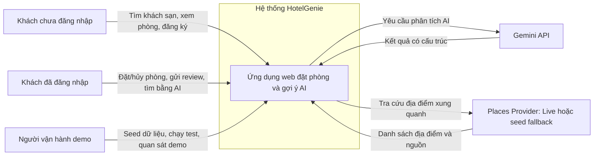
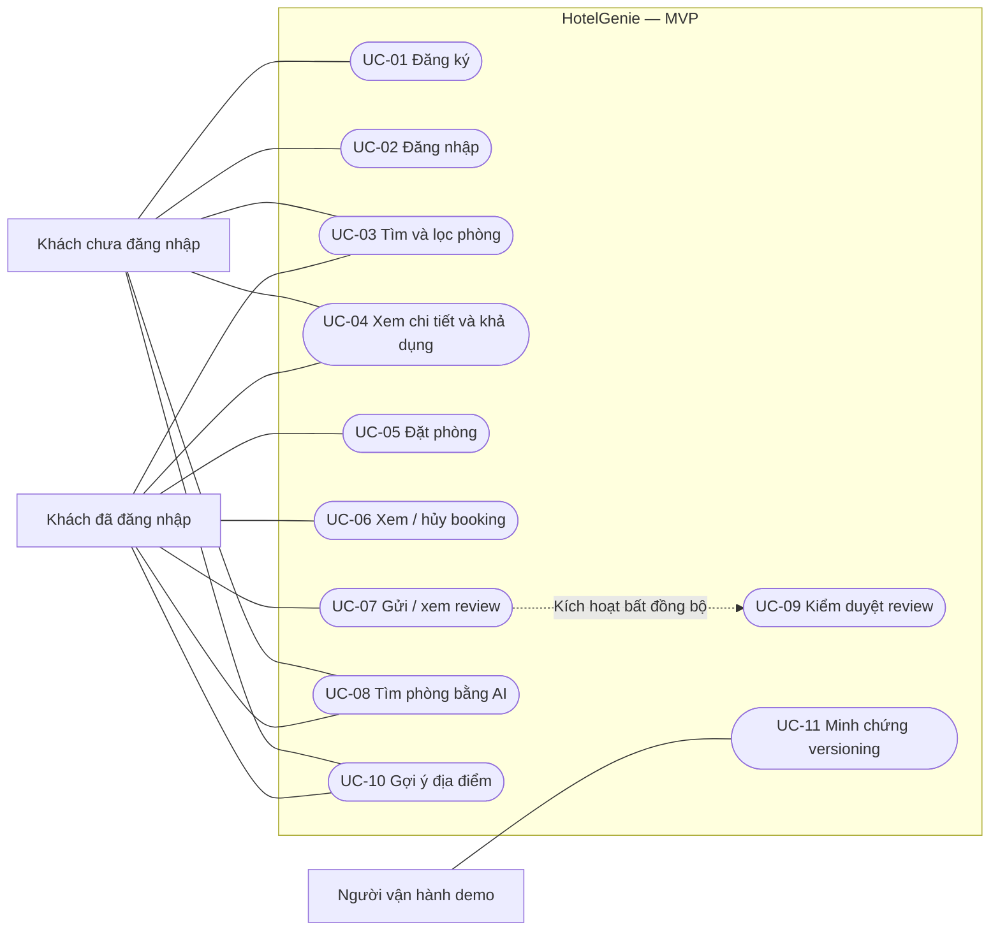
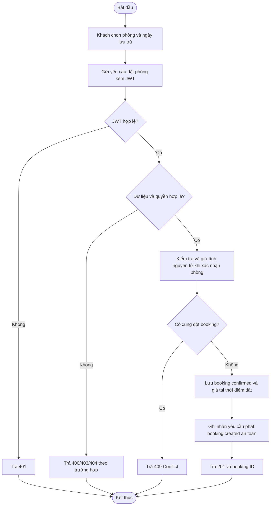

# HotelGenie — Đặc tả yêu cầu phần mềm (SRS)

**Mã tài liệu:** HG-SRS-02  
**Phiên bản:** 1.0 
**Ngày:** 19/11/2026  
**Tài liệu nền:** `HotelGenie_Project_Charter_Scope_VI_v1.2.md`
**Phạm vi:** MVP học phần SOA, nhóm 5 thành viên, 4 tuần.

> **Quy ước trạng thái:** **Đã chốt** = kế thừa quyết định từ Project Charter; **Đề xuất** = chi tiết hóa để nhóm duyệt; **Chưa quyết định** = chưa được tự ý coi là yêu cầu chính thức. Các tiêu chí trong tài liệu là mục tiêu nghiệm thu, **không phải kết quả đã kiểm thử**.

## 1. Giới thiệu

### 1.1. Mục đích
Đặc tả hành vi quan sát được, các ràng buộc và tiêu chí chấp nhận của HotelGenie để nhóm phát triển song song, thống nhất hợp đồng API/event, xây dựng kiểm thử và báo cáo minh chứng vận dụng B1–B9 của môn Kiến trúc hướng dịch vụ.

### 1.2. Tổng quan sản phẩm
HotelGenie là ứng dụng web tìm và đặt phòng khách sạn, hỗ trợ AI tìm kiếm bằng tiếng Việt, phân tích/kiểm duyệt đánh giá, gợi ý dịch vụ xung quanh khách sạn. Frontend trao đổi qua REST API; các backend service trao đổi đồng bộ qua REST và bất đồng bộ qua Redis Streams.

### 1.3. Phạm vi và mức ưu tiên
- **P0 (MVP):** tài khoản/JWT, danh sách và tìm phòng, chi tiết phòng, đặt/xem/hủy booking, review có kiểm duyệt, ba chức năng AI, REST + Redis Streams, kiểm thử và Docker Compose.
- **P1 (nếu còn thời gian):** quản trị cơ bản, AI hỗ trợ mô tả phòng có duyệt, email, lịch sử chat.
- **P2 (ngoài phạm vi):** thanh toán thật, tích hợp OTA, đặt xe thật, bản đồ trực tiếp trên giao diện, mobile native, huấn luyện mô hình, giá động phức tạp.

### 1.4. Thuật ngữ
| Thuật ngữ | Ý nghĩa |
|---|---|
| Service | Thành phần cung cấp năng lực nghiệp vụ qua hợp đồng giao tiếp |
| API contract | Đặc tả request/response, status, schema, security |
| Event | Thông điệp về sự kiện đã xảy ra, phát qua Redis Streams |
| Booking | Bản ghi đặt phòng theo khoảng ngày |
| Check-in / Check-out | Ngày nhận / trả phòng; khoảng lưu trú quy ước `[check_in, check_out)` |
| Availability | Khả năng nhận booking cho phòng và khoảng ngày được yêu cầu |
| Moderation | Kiểm duyệt nội dung review |
| Places Provider | Nguồn dữ liệu địa điểm thực hoặc seed dự phòng |
| Idempotency | Xử lý lặp không gây tác động nghiệp vụ ngoài dự kiến |
| Contract-first | Thống nhất hợp đồng giao tiếp trước khi các bên tích hợp |

## 2. Bối cảnh hệ thống và tác nhân

### 2.1. Tác nhân
| Mã | Tác nhân | Vai trò |
|---|---|---|
| ACT-01 | Khách chưa đăng nhập | Xem và tìm khách sạn/phòng; đăng ký/đăng nhập |
| ACT-02 | Khách đã đăng nhập | Thực hiện quyền của ACT-01; tạo/xem/hủy booking của mình; gửi review |
| ACT-03 | Người vận hành demo | Khởi tạo dữ liệu và quan sát log/test qua công cụ kỹ thuật; **chưa yêu cầu giao diện admin P0** |
| EXT-01 | Gemini API | Phân tích prompt, review và diễn giải gợi ý |
| EXT-02 | Places Provider | Trả danh sách địa điểm gần tọa độ khách sạn |
| SYS-01 | Redis Streams consumer | Nhận, xử lý, xác nhận event bất đồng bộ |

### 2.2. Ranh giới hệ thống (đề xuất, cần SAD xác nhận)
- Auth Service: định danh, mật khẩu, JWT.
- Hotel Service: dữ liệu khách sạn/phòng, tìm kiếm và biểu diễn khả dụng.
- Booking Service: vòng đời booking, quyết định cuối cùng về đặt phòng và chống đặt trùng.
- Review Service: review và trạng thái kiểm duyệt.
- AI Service: diễn giải truy vấn, moderation, nearby recommendation; Gemini Adapter và Places Provider Adapter.
- API Gateway: định tuyến và các chính sách chung, không chứa nghiệp vụ.
- Mỗi service sở hữu dữ liệu riêng về mặt logic; không ghi trực tiếp vào bảng thuộc service khác.

### 2.3. Giả định
- Dữ liệu khách sạn, phòng, tài khoản demo và địa điểm dự phòng được seed.
- Đơn vị giá demo là VND; chưa có thanh toán trực tuyến.
- Gemini có thể thiếu quota hoặc tạm lỗi; test tự động sử dụng mock.
- Provider live cho địa điểm **chưa chọn** (Google Places hoặc OSM/Overpass là ứng viên).
- Các thời hạn booking, quyền review và quy tắc giá chi tiết cần nhóm chốt trước khi đóng băng P0.

### 2.4. Sơ đồ ngữ cảnh hệ thống (System Context Diagram)

Sơ đồ xác định **ranh giới HotelGenie** và các tác nhân/hệ thống bên ngoài. Các service nội bộ không được tách ra ở sơ đồ này; kiến trúc service chi tiết thuộc tài liệu SAD.

**Ghi chú:** Seed fallback là thành phần dự phòng do hệ thống quản lý, được thể hiện cùng giao diện Places Provider để nhấn mạnh khả năng thay thế nguồn dữ liệu; không phải một API bên ngoài bắt buộc.

## 3. Danh mục use case

| Mã | Use case | Tác nhân chính | Ưu tiên |
|---|---|---|---|
| UC-01 | Đăng ký tài khoản | ACT-01 | P0 |
| UC-02 | Đăng nhập và truy cập chức năng bảo vệ | ACT-01/02 | P0 |
| UC-03 | Xem, lọc, phân trang khách sạn/phòng | ACT-01/02 | P0 |
| UC-04 | Xem chi tiết phòng và khả dụng | ACT-01/02 | P0 |
| UC-05 | Đặt phòng | ACT-02 | P0 |
| UC-06 | Xem và hủy booking của mình | ACT-02 | P0 |
| UC-07 | Gửi và xem review | ACT-02 | P0 |
| UC-08 | Tìm phòng bằng ngôn ngữ tự nhiên | ACT-01/02 | P0 |
| UC-09 | Kiểm duyệt review bất đồng bộ | SYS-01 | P0 |
| UC-10 | Gợi ý địa điểm gần khách sạn | ACT-01/02 | P0 |
| UC-11 | Minh chứng versioning API | ACT-03 | P0 (minh chứng SOA) |

### 3.1. Sơ đồ use case tổng quan

Sơ đồ dưới đây dùng ký pháp Mermaid để **minh họa quan hệ tác nhân – chức năng**, không phải bản UML Use Case chuẩn tuyệt đối. Các mã UC tương ứng với bảng ở mục 3.

**Lưu ý:** UC-09 do consumer hệ thống thực hiện sau khi review được gửi; không phải thao tác trực tiếp của khách. UC-11 là kịch bản minh chứng kỹ thuật, không phải chức năng kinh doanh dành cho khách hàng.

## 4. Yêu cầu chức năng (Functional Requirements)

**Quy tắc:** Mỗi yêu cầu có ID duy nhất; P0 phải có ít nhất một test hoặc kịch bản demo tương ứng. Endpoint trong bảng chỉ là **minh họa**, tên chính thức sẽ được chốt ở tài liệu API Contracts.

### 4.1. Tài khoản và xác thực
| ID | Yêu cầu | Tiêu chí chấp nhận |
|---|---|---|
| FR-AUTH-01 | Người dùng đăng ký bằng thông tin bắt buộc hợp lệ. | Đăng ký hợp lệ tạo tài khoản; email trùng hoặc dữ liệu sai trả 4xx có mã lỗi rõ ràng. |
| FR-AUTH-02 | Người dùng đăng nhập bằng thông tin xác thực. | Đúng thông tin nhận JWT; sai thông tin không cấp token. |
| FR-AUTH-03 | Endpoint riêng tư yêu cầu JWT hợp lệ. | Thiếu/hết hạn/sai token trả 401; không rò thông tin nhạy cảm. |
| FR-AUTH-04 | Kiểm tra quyền trên từng tài nguyên thuộc người dùng. | Không thể đọc/hủy booking của người khác; trả 403 hoặc 404 theo chính sách đã thống nhất. |
| FR-AUTH-05 | Giao diện cho phép đăng xuất. | Token không còn được frontend sử dụng; **thu hồi JWT phía server chưa chốt**. |

### 4.2. Danh mục khách sạn, phòng và tìm kiếm
| ID | Yêu cầu | Tiêu chí chấp nhận |
|---|---|---|
| FR-HOTEL-01 | Xem danh sách khách sạn và thông tin tóm tắt. | Trả danh sách JSON có định danh ổn định và các trường công khai. |
| FR-HOTEL-02 | Xem khách sạn và các phòng liên quan. | ID tồn tại trả 200; không tồn tại trả 404. |
| FR-HOTEL-03 | Lọc theo địa điểm, ngày nhận/trả, số khách và khoảng giá. | Kết quả đáp ứng bộ lọc; bộ lọc sai trả lỗi 4xx, không trả 500. |
| FR-HOTEL-04 | Phân trang và sắp xếp danh sách. | Kết quả có metadata phân trang, thứ tự ổn định và giới hạn kích thước trang. |
| FR-HOTEL-05 | Xem chi tiết phòng, sức chứa, giá demo và trạng thái khả dụng theo ngày. | Kết quả có nguồn từ dữ liệu lưu trữ, không do AI tự sinh. |
| FR-HOTEL-06 | Xác thực điều kiện ngày lưu trú. | `check_out` phải sau `check_in`; ngày không hợp lệ trả 400/422 theo hợp đồng. |

### 4.3. Booking
| ID | Yêu cầu | Tiêu chí chấp nhận |
|---|---|---|
| FR-BOOK-01 | Người đã đăng nhập tạo booking cho phòng và khoảng ngày hợp lệ. | Thành công tạo một booking với ID, owner, ngày, trạng thái, giá tại thời điểm đặt; trả 201. |
| FR-BOOK-02 | Ngăn đặt trùng phòng trong các khoảng ngày giao nhau. | Hai yêu cầu đồng thời đặt cùng phòng/đêm không thể cùng được xác nhận; trường hợp xung đột trả 409. |
| FR-BOOK-03 | Người dùng xem danh sách và chi tiết booking của mình. | Không thể truy cập booking người khác; dữ liệu nhất quán với bản ghi đã tạo. |
| FR-BOOK-04 | Người dùng hủy booking hợp lệ. | Booking chuyển trạng thái hủy; không còn chặn khả dụng theo quy tắc đã thống nhất. |
| FR-BOOK-05 | Xử lý lặp request tạo/hủy booking an toàn theo hợp đồng. | Retry có idempotency key không tạo thêm booking; hủy lặp không phát sinh tác động ngoài ý muốn. **Cách trả status cho hủy lặp sẽ chốt trong API Contract.** |
| FR-BOOK-06 | Phát `booking.created` và `booking.cancelled` khi trạng thái đã được ghi nhận. | Event có ID, booking ID, thời gian và version; có log/consumer để kiểm chứng; tránh mất event giữa commit DB và publish bằng cơ chế sẽ chọn trong SAD. |

**Quy tắc nghiệp vụ đề xuất:** Một booking giữ đúng một phòng vật lý; khoảng lưu trú `[check_in, check_out)`; booking đã hủy không chặn phòng. Nếu hệ thống chọn đặt theo *loại phòng + số lượng*, cần thay đổi mô hình availability và test concurrency tương ứng. Đây là quyết định **chưa chốt**, không mặc nhiên coi là đã duyệt.

### 4.4. Review
| ID | Yêu cầu | Tiêu chí chấp nhận |
|---|---|---|
| FR-REV-01 | Người đăng nhập gửi review gồm điểm số và nội dung. | Dữ liệu hợp lệ tạo review ở trạng thái `pending`; dữ liệu sai bị từ chối. |
| FR-REV-02 | Phát `review.submitted` sau khi lưu review. | Consumer AI nhận được event theo contract; có thể truy vết event ID. |
| FR-REV-03 | AI đánh giá sentiment và cờ kiểm duyệt. | Kết quả có cấu trúc, có nhãn/lý do; không tự ý xuất bản review trước khi hoàn thành chính sách kiểm duyệt. |
| FR-REV-04 | Review Service tiếp nhận kết quả moderation. | Review chuyển sang `approved` hoặc `flagged`/`rejected` theo chính sách; xử lý lặp event không gây chuyển trạng thái sai. |
| FR-REV-05 | Chỉ hiển thị review theo trạng thái cho phép. | Review pending/không được duyệt không xuất hiện trong danh sách công khai. |
| FR-REV-06 | Xử lý AI lỗi hoặc không phản hồi. | Review vẫn được lưu ở `pending`/trạng thái lỗi chờ xử lý; không tự động duyệt khi chưa có kết quả. |

**Chưa chốt:** Chỉ khách đã hoàn tất lưu trú mới được review hay mọi người dùng đăng nhập; quy tắc mỗi booking được review bao nhiêu lần; thang điểm (đề xuất 1–5).

### 4.5. AI tìm phòng bằng prompt
| ID | Yêu cầu | Tiêu chí chấp nhận |
|---|---|---|
| FR-AI-01 | Nhận câu tìm kiếm tiếng Việt tự nhiên. | Ví dụ: “Tìm phòng ở Hà Nội cho 2 người, 2 đêm, dưới 1,5 triệu/đêm”. |
| FR-AI-02 | Chuyển prompt thành bộ lọc có schema cố định. | Kết quả gồm các trường được hỗ trợ (địa điểm, ngày, số khách, ngân sách); trường thiếu/không chắc chắn được để trống hoặc yêu cầu làm rõ. |
| FR-AI-03 | Dùng bộ lọc để gọi chức năng tìm kiếm dữ liệu thực. | Chỉ trả phòng/giá/khả dụng có trong Hotel/Booking data; không tự bịa kết quả. |
| FR-AI-04 | Xử lý prompt không hợp lệ hoặc Gemini lỗi. | Trả lỗi có cấu trúc hoặc chuyển sang tìm kiếm thủ công; không tạo booking ngoài ý muốn. |

### 4.6. AI gợi ý địa điểm xung quanh
| ID | Yêu cầu | Tiêu chí chấp nhận |
|---|---|---|
| FR-PLACE-01 | Tìm địa điểm theo tọa độ khách sạn, bán kính và nhóm nhu cầu. | Places Adapter nhận đầu vào có schema và trả danh sách địa điểm chuẩn hóa. |
| FR-PLACE-02 | Cho phép thay thế live provider mà không đổi API nghiệp vụ. | Google Places/OSM là ứng viên; cùng giao diện `search_nearby(...)`. |
| FR-PLACE-03 | Dùng seed fallback khi live provider timeout/lỗi/quota. | Gợi ý vẫn hoạt động với seed nếu có dữ liệu; kết quả ghi rõ `source` và `is_fallback`. |
| FR-PLACE-04 | AI chọn/xếp hạng/giải thích trên danh sách địa điểm đã nhận. | Không xuất hiện địa điểm không nằm trong đầu ra provider; thông tin không có thì không suy diễn. |
| FR-PLACE-05 | Phân biệt nguồn và khả năng thiếu dữ liệu. | Giao diện thể hiện rõ dữ liệu dự phòng; không trình bày dữ liệu seed là dữ liệu live. |

**Phân biệt:** Live Places API cung cấp *dữ liệu địa điểm*, không đồng nghĩa với yêu cầu nhúng bản đồ tương tác hay đặt xe trực tiếp (P2).

### 4.7. Yêu cầu liên service và API lifecycle
| ID | Yêu cầu | Tiêu chí chấp nhận |
|---|---|---|
| FR-SOA-01 | Các service cung cấp REST resource qua API Gateway/hợp đồng thống nhất. | Có OpenAPI 3.0, request/response mẫu, status và error schema. |
| FR-SOA-02 | Giao tiếp bất đồng bộ qua Redis Streams với producer/consumer rõ ràng. | Demo luồng `review.submitted` → AI → kết quả moderation → Review; booking events quan sát được. |
| FR-SOA-03 | Consumer chịu được event trùng và lỗi tạm thời. | Có test replay cùng event ID; chỉ ACK khi xử lý thành công; có chính sách retry và xử lý lỗi cuối cùng. |
| FR-SOA-04 | Service không truy cập trực tiếp dữ liệu thuộc service khác. | Review kiến trúc/code cho thấy giao tiếp qua contract thay vì cross-service DB access. |
| FR-SOA-05 | API công khai có phiên bản `/api/v1`. | Minh họa một thay đổi v1→v2 hoặc test compatibility; tài liệu migration/breaking change. |
| FR-SOA-06 | Có cơ chế quan sát và kiểm thử tích hợp. | Health endpoint, log có request/event ID, Postman/Newman và pytest cho luồng chính. |

## 5. Đặc tả use case quan trọng

### 5.1. Activity Diagram — Quy trình đặt phòng (UC-05)

Sơ đồ thể hiện **hành vi nghiệp vụ và các nhánh thành công/thất bại**, chưa ấn định giải pháp khóa DB hoặc cơ chế transaction cụ thể (được quyết định ở SAD).

**Các điểm cần kiểm thử:** FR-BOOK-01, FR-BOOK-02, FR-BOOK-05, FR-BOOK-06 và AT-03/AT-04. Hai request đồng thời tranh cùng một phòng/đêm không được cùng xác nhận thành công. Cách bảo đảm event không mất khi DB commit và Redis gặp lỗi sẽ mô tả trong SAD.

### UC-05 — Đặt phòng
- **Tác nhân:** khách đã đăng nhập.
- **Tiền điều kiện:** JWT hợp lệ; phòng tồn tại; ngày và số khách hợp lệ.
- **Luồng chính:** (1) chọn phòng/ngày; (2) gửi yêu cầu tạo booking; (3) Booking Service kiểm tra quy tắc và bảo đảm tính nguyên tử; (4) lưu booking; (5) trả mã booking và trạng thái; (6) phát `booking.created` theo cơ chế bảo đảm phát event.
- **Ngoại lệ:** thiếu JWT → 401; sai dữ liệu → 400/422; phòng không tồn tại → 404; phòng đã bị đặt → 409; sự cố DB → lỗi 5xx được ghi log.
- **Hậu điều kiện:** không có hai booking được xác nhận trùng phòng và khoảng ngày; event có thể được tiêu thụ an toàn.
- **Liên kết:** FR-BOOK-01/02/05/06, FR-AUTH-03.

### UC-08 — Tìm phòng bằng ngôn ngữ tự nhiên
- **Tác nhân:** khách.
- **Luồng chính:** (1) nhập prompt; (2) AI Service chuẩn hóa bộ lọc; (3) validate bộ lọc; (4) gọi Hotel Service qua REST; (5) trả phòng phù hợp cùng thông tin giá/khả dụng từ dữ liệu thật.
- **Ngoại lệ:** thiếu thông tin thiết yếu → trả thông tin cần bổ sung; Gemini lỗi → thông báo và cho phép tìm thủ công.
- **Hậu điều kiện:** không tự tạo booking, không trả phòng/giá không có trong hệ thống.
- **Liên kết:** FR-AI-01..04, FR-HOTEL-03/05.

### UC-09 — Kiểm duyệt review qua Redis Streams
- **Tác nhân:** consumer.
- **Luồng chính:** (1) Review Service lưu `pending`; (2) phát `review.submitted`; (3) AI consumer nhận qua consumer group; (4) kiểm duyệt và phát kết quả có cấu trúc; (5) Review Service xử lý kết quả và cập nhật trạng thái; (6) ACK sau xử lý thành công.
- **Ngoại lệ:** AI lỗi → retry theo chính sách, giữ `pending`; event trùng → bỏ qua tác động lặp; event sai schema → đưa vào cơ chế xử lý lỗi được định nghĩa.
- **Hậu điều kiện:** trạng thái review cuối cùng có thể truy vết theo event ID.
- **Liên kết:** FR-REV-01..06, FR-SOA-02/03.

### UC-10 — Gợi ý địa điểm gần khách sạn
- **Tác nhân:** khách.
- **Luồng chính:** (1) chọn khách sạn và loại hoạt động; (2) lấy tọa độ khách sạn; (3) Places Adapter gọi provider được cấu hình; (4) chuẩn hóa địa điểm; (5) AI chọn và giải thích; (6) trả danh sách và nguồn dữ liệu.
- **Ngoại lệ:** provider lỗi/timeout/quota → seed fallback; không có địa điểm → danh sách rỗng có giải thích; Gemini lỗi → có thể trả danh sách địa điểm chưa được AI xếp hạng, đánh dấu rõ.
- **Liên kết:** FR-PLACE-01..05.

## 6. Quy tắc dữ liệu và trạng thái (đề xuất)

### 6.1. Đối tượng nghiệp vụ
| Đối tượng | Trường cốt lõi | Service sở hữu dự kiến |
|---|---|---|
| User | id, email, password_hash, role, created_at | Auth |
| Hotel | id, name, address, city, latitude, longitude | Hotel |
| Room | id, hotel_id, name/type, capacity, price_per_night, status | Hotel |
| Booking | id, user_id, room_id, check_in, check_out, total_price, status | Booking |
| Review | id, user_id, hotel_id, rating, content, moderation_status | Review |
| Place (DTO) | provider_id, name, category, coordinates, address?, source | AI Adapter (không nhất thiết lưu DB) |

### 6.2. Trạng thái booking
**Đề xuất tối thiểu:** `confirmed` → `cancelled`; trạng thái `pending`/`completed` chỉ bổ sung nếu có quy tắc nghiệp vụ rõ. Không tạo trạng thái thanh toán khi chưa có thanh toán thật.

### 6.3. Trạng thái review
**Đề xuất:** `pending` → `approved` hoặc `flagged`/`rejected`. Chính sách quyết định `flagged` có công khai hay không phải chốt; mặc định **không công khai**.

### 6.4. Giá và thời gian
- Giá phòng lưu theo VND/đêm; tổng giá demo = số đêm × đơn giá tại thời điểm đặt (nếu chưa có phụ phí).
- Dùng ngày địa phương cho check-in/check-out, timestamp có múi giờ cho audit/event.
- Không khẳng định availability chỉ bằng trạng thái phòng tĩnh; phải xét booking giao nhau.

## 7. Yêu cầu giao tiếp và hợp đồng

### 7.1. REST
- URI resource dùng danh từ số nhiều, chữ thường, phân cấp hợp lý; `/api/v1/...`.
- GET không thay đổi dữ liệu; POST tạo resource trả 201 khi thành công; 400/422 cho input sai; 401 chưa xác thực; 403 thiếu quyền; 404 không tồn tại; 409 xung đột.
- Response lỗi có mã máy đọc được, thông điệp và request ID (định dạng chính thức ở API Contracts).
- Các danh sách hỗ trợ giới hạn kết quả; query parameters được validate; OpenAPI định nghĩa schema.
- Ví dụ dự kiến: `GET /api/v1/hotels`, `GET /api/v1/hotels/{id}`, `GET /api/v1/rooms/{id}`, `POST /api/v1/bookings`, `GET /api/v1/bookings`, `POST /api/v1/reviews`, `POST /api/v1/ai/search`, `GET /api/v1/hotels/{id}/nearby`.

### 7.2. Redis Streams
| Event dự kiến | Producer | Consumer | Ý nghĩa |
|---|---|---|---|
| `booking.created` | Booking | Consumer quan sát/demo hoặc service có nhu cầu | Booking đã được tạo |
| `booking.cancelled` | Booking | Consumer quan sát/demo hoặc service có nhu cầu | Booking đã bị hủy |
| `review.submitted` | Review | AI | Có review mới cần kiểm duyệt |
| `review.moderated` | AI | Review | Có kết quả kiểm duyệt |

**Schema chung đề xuất:** `event_id`, `event_type`, `event_version`, `occurred_at`, `correlation_id`, `producer`, `payload`. Tên stream, consumer group, retry limit, DLQ và chiến lược transactional outbox là **quyết định SAD/API Events**, chưa chốt tại SRS.

## 8. Yêu cầu phi chức năng (NFR)

| ID | Yêu cầu | Phương pháp kiểm chứng |
|---|---|---|
| NFR-01 | Chạy toàn bộ hệ thống demo bằng Docker Compose với `.env.example`. | Trên môi trường sạch, cấu hình `.env`, chạy `docker compose up --build` và kiểm tra health. |
| NFR-02 | Mật khẩu hash; secrets không commit; kiểm tra AuthN/AuthZ. | Review config/code; test 401/403; kiểm tra `.gitignore`. |
| NFR-03 | Booking không tạo đặt trùng khi có request đồng thời. | Integration/concurrency test với hai request tranh cùng phòng và khoảng ngày. |
| NFR-04 | Lỗi Gemini/Places không làm sai hoặc hỏng dữ liệu booking. | Test mock timeout/error và kiểm tra trạng thái booking không bị ảnh hưởng. |
| NFR-05 | Redis consumer idempotent, có retry và xử lý lỗi quan sát được. | Replay event, giả lập consumer crash/restart; đối chiếu log/trạng thái. |
| NFR-06 | Các service có health endpoint, log lỗi, request/event correlation. | Demo health, đối chiếu log theo ID. |
| NFR-07 | API có OpenAPI 3.0, ví dụ request/response và contract test. | Lint spec, chạy schema/contract tests. |
| NFR-08 | Có pytest và Postman/Newman cho happy/error/edge cases. | Lưu kết quả thực thi test vào báo cáo, không chỉ liệt kê test case. |
| NFR-09 | Đo hiệu năng API ở mức demo, không tự tuyên bố SLA production. | Nếu thực hiện, dùng Locust đo RPS, error rate, p50/p95 và ghi điều kiện tải. |
| NFR-10 | Tích hợp thường xuyên từ tuần 1, không chờ hoàn thành từng service. | Repo có PR, mock contracts, build/test tích hợp định kỳ. |
| NFR-11 | Dữ liệu địa điểm từ provider được gắn nguồn, fallback rõ ràng. | Test timeout provider và xác nhận `source`/`is_fallback`. |
| NFR-12 | Các test tự động thông thường không cần gọi Gemini hoặc live Places. | Chạy suite với mock provider và không cấu hình API key thật. |

**Chưa ấn định ngưỡng:** p95, throughput, uptime, thời gian phản hồi AI. Nhóm cần đo baseline thực tế trước khi đưa ra chỉ tiêu số; tránh đặt SLA thiếu cơ sở.

## 9. Tiêu chí nghiệm thu cấp hệ thống (Acceptance Scenarios)

| ID | Kịch bản | Kết quả mong đợi |
|---|---|---|
| AT-01 | Đăng ký → đăng nhập → gọi API có JWT | Thành công; thiếu token bị từ chối |
| AT-02 | Tìm khách sạn theo thành phố/ngày/số khách/giá | Trả đúng dữ liệu seed và phân trang |
| AT-03 | Đặt phòng hợp lệ → xem booking → hủy | Trạng thái và dữ liệu thay đổi đúng |
| AT-04 | Hai request cùng đặt một phòng và đêm giao nhau | Tối đa một booking được xác nhận |
| AT-05 | Tạo review → Redis event → AI moderation → Review update | Có log event, trạng thái cuối đúng, không công khai pending |
| AT-06 | Phát lại cùng event moderation | Không tạo tác động lặp |
| AT-07 | Prompt tiếng Việt → filters → tìm phòng | Kết quả có thật, không bịa giá/phòng |
| AT-08 | Live Places lỗi → seed fallback | Có gợi ý dự phòng, đánh dấu nguồn |
| AT-09 | Thử JWT của người A để truy cập booking người B | Bị từ chối |
| AT-10 | Docker Compose khởi chạy toàn hệ thống | Frontend, gateway, service, DB, Redis hoạt động |
| AT-11 | Chạy Newman/pytest và kiểm tra hợp đồng OpenAPI | Có log/report PASS/FAIL thực tế |
| AT-12 | Minh họa API v1/v2 hoặc migration compatibility | Giải thích được breaking change và tác động đến client |

## 10. Ma trận truy vết môn SOA (B1–B9)

| Bài | Yêu cầu liên quan | Minh chứng cần thu thập |
|---|---|---|
| B1 — API & Web Services | FR-SOA-01/04 | Sơ đồ ranh giới service, bảng hợp đồng |
| B2 — REST & HTTP | FR-HOTEL-01..06, FR-BOOK-01..04 | Endpoint, methods, status codes, statelessness |
| B3 — API Design | FR-HOTEL-04/06, FR-BOOK-05 | Naming, filtering, pagination, validation, idempotency |
| B4 — OpenAPI | FR-SOA-01, NFR-07 | `openapi.yaml`, Swagger UI, lint/contract test |
| B5 — Data Modeling | FR-HOTEL-01..05, FR-BOOK-02 | ERD, resource-vs-DB mapping, ownership |
| B6 — AuthN/AuthZ | FR-AUTH-01..05 | JWT, test 401/403, owner checks |
| B7 — Backend Service | FR-SOA-04/06, NFR-01/06 | Flask factory/blueprints, SQLAlchemy, Docker, health |
| B8 — API Testing & QA | NFR-03/05/08/09, AT-01..11 | Pytest, Newman, concurrency/contract/performance report |
| B9 — Versioning | FR-SOA-05, AT-12 | `/api/v1`, v1→v2 demo/migration note |
| SOA tích hợp | FR-SOA-02/03, FR-REV-02..04 | Redis Streams producer/consumer, replay, retry, sequence diagram |

**Quy tắc báo cáo:** Bằng chứng phải có liên kết đến file code/spec/test, lệnh chạy và kết quả thực tế; không đánh dấu “đã áp dụng” nếu chỉ có sơ đồ hoặc kế hoạch.

## 11. Ràng buộc kỹ thuật đã chốt
React + Vite; Python + Flask; PostgreSQL + SQLAlchemy; REST + OpenAPI 3.0; Redis Streams; Gemini API qua Provider Interface; Places Provider Adapter (live provider chưa chốt, seed fallback); JWT; Docker + Docker Compose; pytest + Postman/Newman; Markdown tiếng Việt. Nhóm phát triển song song, ownership linh hoạt, contract-first và tích hợp liên tục từ tuần 1.

## 12. Những quyết định cần nhóm review trước khi phê duyệt SRS
| Mã | Vấn đề | Đề xuất để thảo luận | Ảnh hưởng |
|---|---|---|---|
| DEC-01 | Đặt theo phòng vật lý hay loại phòng + số lượng? | Phòng vật lý cho MVP | Booking model, concurrency |
| DEC-02 | Ai được phép review? | Người dùng có booking hoàn tất (nếu có completed); nếu không, chọn quy tắc đơn giản có chống spam | Review/Auth |
| DEC-03 | Thang điểm và giới hạn review? | 1–5 sao, một review mỗi booking nếu gắn booking | Review schema |
| DEC-04 | Chính sách hủy booking? | Cho hủy khi chưa đến check-in | Booking states |
| DEC-05 | Refresh/revoke JWT? | Access JWT ngắn hạn; quy tắc logout phía server quyết định sau | Auth/security |
| DEC-06 | Live Places provider? | Spike Google Places và OSM/Overpass, chưa chọn | Quota, adapter, demo |
| DEC-07 | Event reliability? | Xem xét transactional outbox + idempotent consumer | SAD, DB, Redis |
| DEC-08 | Trạng thái booking và giá? | confirmed/cancelled; giá cố định VND/đêm | UI, DB, test |
| DEC-09 | Admin frontend P0? | Không; seed script thay thế | Phạm vi 4 tuần |
| DEC-10 | Cách triển khai versioning minh chứng? | Một endpoint v2 nhỏ + compatibility test | B9 demo |ss
