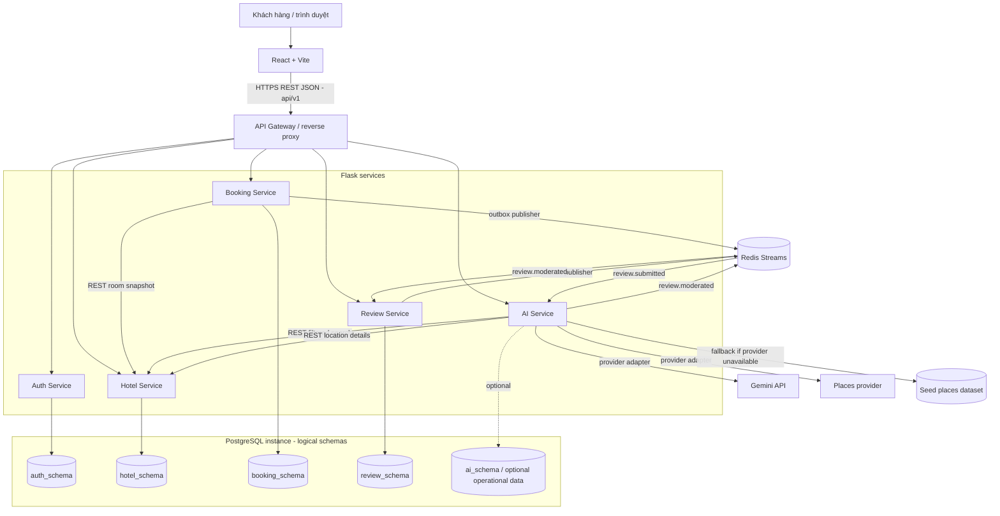
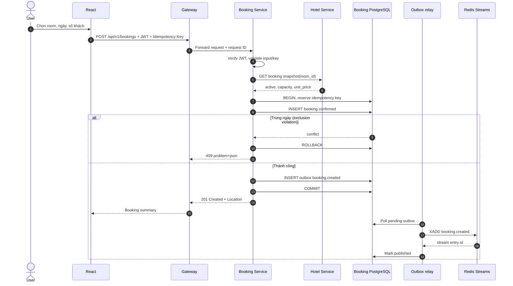
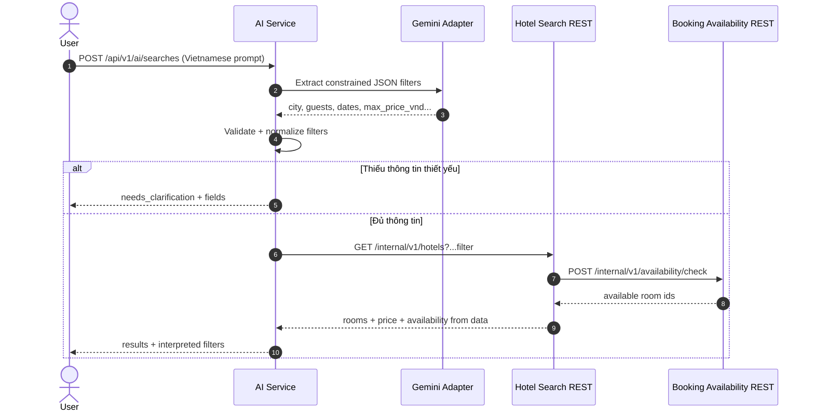
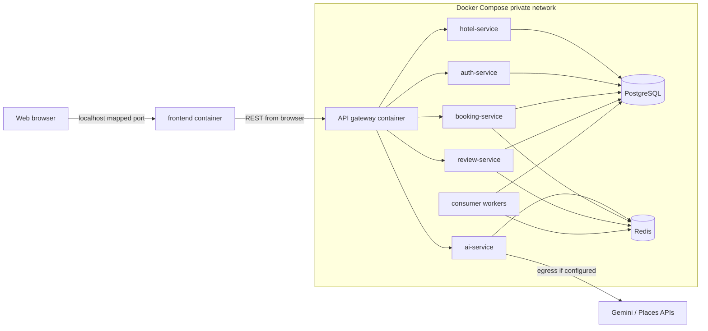

# HotelGenie — Software Architecture Document (SAD)

**Mã:** HG-SAD-03 · **Phiên bản:** v1.0 — Proposed / Implementation-ready draft · **Ngày:** 19/11/2026  
**Cơ sở:** Project Charter & Scope v1.0; SRS v1.0; chín bài giảng SOA B1–B9 đính kèm.\
**Đối tượng:** nhóm 5 thành viên, 4 tuần; mục tiêu bản mẫu dùng lại được cho MVP, không phải kiến trúc production quy mô lớn.

> **Nguyên tắc sử dụng:** “Đã thống nhất” = kế thừa Charter; “Quyết định kỹ thuật đề xuất” = phương án SAD đưa ra để có thể code nhưng cần nhóm review; “Chưa chốt” = không tự ý coi là đã phê duyệt. Sơ đồ bên dưới mô tả **kiến trúc mục tiêu**, không phải thành phần đã triển khai.

## 1. Mục tiêu, phạm vi và liên kết yêu cầu

### 1.1. Mục đích kiến trúc
Định nghĩa ranh giới service, dữ liệu do từng service quản lý, REST API và Redis Streams, luồng thực thi nghiệp vụ, cơ chế đảm bảo nhất quán khi đặt phòng, yêu cầu bảo mật, khả năng kiểm thử và môi trường chạy. SAD hướng tới thiết kế **đủ cụ thể để mỗi thành viên triển khai độc lập dựa trên contract**, đồng thời giải thích vì sao những quyết định đó thể hiện kiến thức SOA.

### 1.2. Kiến trúc đã thống nhất từ Charter / SRS
- React + Vite; Flask; PostgreSQL + SQLAlchemy; OpenAPI; JWT; REST (đồng bộ); Redis Streams (bất đồng bộ); Docker Compose; Gemini API và Places Provider Adapter có seed fallback.
- Có Auth, Hotel, Booking, Review, AI Service và Gateway. Mỗi service sở hữu dữ liệu nghiệp vụ riêng về mặt logic; không đọc/ghi trực tiếp bảng của service khác.
- P0 gồm tài khoản, tìm khách sạn/phòng, booking/hủy, review/moderation, prompt search, nearby suggestions; dữ liệu seed; test và minh chứng B1–B9.
- Cả nhóm phát triển song song từ tuần 1, hợp đồng xác định trước, mock các service chưa hoàn thành, tích hợp thường xuyên.

### 1.3. Yêu cầu kiến trúc truy vết
| Architectural requirement | Yêu cầu SRS | Bảo đảm thiết kế |
|---|---|---|
| AR-01 Tách business capabilities | FR-SOA-01/04 | Các service độc lập, hợp đồng rõ, tránh shared business database |
| AR-02 HTTP đúng nghĩa, stateless | FR-HOTEL, FR-BOOK, FR-SOA-01 | REST resource-oriented, HTTP codes, JWT mỗi request |
| AR-03 Booking không overbook | FR-BOOK-01/02, NFR-03 | Ràng buộc giao nhau trong Booking DB + giao dịch |
| AR-04 Event bền vững / idempotent | FR-BOOK-06, FR-REV-02/04, FR-SOA-02/03 | Outbox relay, Redis Streams, inbox/dedupe, ACK/retry |
| AR-05 Quản lý dữ liệu và API schema | FR-SOA-01, NFR-07 | DTO tách ORM, OpenAPI 3.0.3, migration và lint |
| AR-06 Bảo mật theo tài nguyên | FR-AUTH-01..05, NFR-02 | JWT validation, ownership check, không lộ secrets |
| AR-07 AI không bịa dữ liệu | FR-AI-01..04, FR-PLACE-01..05 | Structured filters + Hotel API; provider-backed places |
| AR-08 Vận hành và kiểm thử được | NFR-01/04/05/06/08/12 | Docker Compose, health/log, pytest/Newman/mock |
| AR-09 Có vòng đời API | FR-SOA-05, AT-12 | `/api/v1`, compatibility demo v2 |

## 2. Phong cách kiến trúc và kiến trúc tổng quan

### 2.1. Quyết định kiến trúc
**Đề xuất:** Service-oriented architecture ở quy mô đồ án: 5 Flask service tách tiến trình/container; một API Gateway định tuyến; mỗi service sở hữu schema PostgreSQL riêng; đồng bộ bằng HTTP/REST và sự kiện qua Redis Streams. Không xem việc có nhiều container là đủ để chứng minh SOA: phải có *service contract, ownership, loose coupling và các luồng thực sự chạy*.

Lý do chọn: phù hợp nội dung B1 (API là hợp đồng, service gắn với business capability), B2 (client-server, stateless, layered system), B4 (OpenAPI), B7 (Flask service + Docker). **Tradeoff:** nhiều process, cấu hình và network failure hơn monolith; giới hạn ở 5 service để nhóm có thể hoàn thành trong 4 tuần.

### 2.2. Component/container diagram



**Sơ đồ logic, không phải sơ đồ toàn bộ đường kết nối TCP.** Mũi tên DB thể hiện *quyền sở hữu dữ liệu*: một service chỉ sử dụng schema của mình. AI schema là tùy chọn cho cache/audit, **không phải** nơi sao chép dữ liệu khách sạn. HTTPS áp dụng phía client/gateway ở triển khai public; trong Docker demo dùng HTTP nội bộ, không công khai trực tiếp các service.

### 2.3. Đường đồng bộ và bất đồng bộ
- **REST** cho truy vấn/command cần kết quả ngay: đăng nhập, tìm phòng, lấy room snapshot, kiểm tra điều kiện đặt và hủy, truy xuất khách sạn/tọa độ.
- **Redis Streams** cho sự kiện đã xảy ra: `booking.created`, `booking.cancelled`, `review.submitted`, `review.moderated`. Không dùng event bus làm cơ chế khóa phòng hoặc giao thức RPC chờ AI.
- **Gateway** chỉ routing, CORS, request ID, rate limiting đơn giản (nếu có), JWT check chung tùy cấu hình; authorization theo chủ sở hữu **bắt buộc trong service**. Không đưa booking business logic vào gateway.

## 3. Service boundaries và data ownership

| Service | Nhiệm vụ | Data owner (PostgreSQL) | Không chịu trách nhiệm |
|---|---|---|---|
| Auth | User identity, password hash, JWT, role | `auth.users` | Booking, hotel listing |
| Hotel | Hotel/room catalog, giá niêm yết demo, sức chứa, tọa độ, filtering/pagination | `hotel.hotels`, `hotel.rooms` | Quyết định cuối cùng về giữ phòng |
| Booking | Tạo/hủy/xem booking, quyền sở hữu, chống trùng lịch, snapshot giá, event outbox | `booking.bookings`, `booking.outbox`, `booking.idempotency_keys` | Duy trì thông tin hotel/room chính thức |
| Review | Nội dung/rating/trạng thái moderation, publish/consume events | `review.reviews`, `review.outbox`, `review.processed_events` | Gọi LLM trong request tạo review |
| AI | Chuẩn hóa prompt, moderation, nearby, provider interface, publish moderation event | `ai` optional + processed IDs | Nguồn sự thật về phòng, giá, booking |

**Ràng buộc:** `booking.room_id`, `review.hotel_id`, `review.user_id` là external reference theo ID ổn định; **không dùng FK xuyên schema/service** vì phá data ownership. Khi cần xác minh sự tồn tại/thuộc tính, dùng API của service owner. Trong demo, delete phòng/khách sạn nên là **soft delete / deactivate**, tránh phá booking cũ.

**Contract giữa dịch vụ:** ID thống nhất UUID string; UTC ISO-8601 cho event timestamps; `check_in`, `check_out` dạng `YYYY-MM-DD`; VND nguyên (`price_per_night_vnd`, `total_price_vnd`). Đây là quy ước đề xuất để các nhóm code đồng nhất, sẽ được đóng băng tại `04-api-events.md`.

## 4. Thiết kế REST và tài nguyên

### 4.1. Quy ước REST (B2/B3/B5)
- `/api/v1` cho public gateway; danh từ số nhiều, lowercase, đường dẫn ngắn; GET không đổi business state; POST tạo resource; PATCH đổi một phần; không ẩn hành động có side effect trong GET.
- Stateless: mỗi request đủ token/input, không phụ thuộc Flask in-memory session. DB/cache có thể tồn tại — **stateless không đồng nghĩa không có DB**.
- HTTP: `200` truy xuất, `201` tạo (+ `Location`), `204` thao tác không body, `400` JSON/query sai, `401` thiếu/sai auth, `403` không đủ quyền, `404` resource không tồn tại, `409` xung đột phòng/idempotency, `422` dữ liệu hợp lệ cú pháp nhưng sai schema/business validation nếu được thống nhất.
- Error JSON chuẩn **Problem Details** (`application/problem+json`): `type`, `title`, `status`, `detail`, `instance`, `code`, `request_id` (extensions). B3 đề cập RFC 7807/9457; chọn RFC 9457 khi viết contract, tương thích tinh thần bài giảng.
- Phân trang danh sách: **offset** `page`, `per_page` (MVP dataset nhỏ), ổn định bằng `sort` có tie-breaker theo ID; cho phép `city`, `min_price_vnd`, `max_price_vnd`, `guests`, `check_in`, `check_out`. **Chú ý:** khả dụng theo ngày không thể tin vào field tĩnh của Hotel Service.

### 4.2. Endpoint inventory dự kiến (KHÔNG thay thế OpenAPI)
| Owner | Method / route public | Auth | Mục đích / FR |
|---|---|---|---|
| Auth | `POST /api/v1/auth/register` | No | FR-AUTH-01; hành động auth được xem là endpoint quy trình đặc thù |
| Auth | `POST /api/v1/auth/token` | No | FR-AUTH-02 |
| Auth | `GET /api/v1/users/me` | Yes | current user |
| Hotel | `GET /api/v1/hotels` | No | FR-HOTEL-01/03/04 |
| Hotel | `GET /api/v1/hotels/{hotel_id}` | No | FR-HOTEL-02 |
| Hotel | `GET /api/v1/hotels/{hotel_id}/rooms` | No | FR-HOTEL-02/05 |
| Hotel | `GET /api/v1/rooms/{room_id}` | No | room details |
| Booking | `POST /api/v1/bookings` | Yes | FR-BOOK-01/02/05 |
| Booking | `GET /api/v1/bookings` | Yes | only own bookings by default |
| Booking | `GET /api/v1/bookings/{booking_id}` | Yes | FR-BOOK-03 |
| Booking | `PATCH /api/v1/bookings/{booking_id}` | Yes | set `status=cancelled` — proposal for FR-BOOK-04 |
| Review | `POST /api/v1/reviews` | Yes | FR-REV-01 |
| Review | `GET /api/v1/hotels/{hotel_id}/reviews` | No | approved only; gateway routes to Review |
| AI | `POST /api/v1/ai/searches` | No | FR-AI-01..04, JSON query → filters/results |
| AI | `GET /api/v1/hotels/{hotel_id}/nearby-places` | No | FR-PLACE-01..05; gateway routes to AI |

**Quan trọng cần xử lý ở Contracts:** SRS yêu cầu tìm kiếm theo ngày trả *khả dụng thực*. Nếu Hotel DB không sở hữu booking thì không thể chỉ `GET /hotels?check_in=...` nội bộ Hotel SQL để tuyên bố còn phòng. **Đề xuất phối hợp:** Gateway/Hotel Search façade chỉ sắp xếp catalog; Booking Service cung cấp endpoint nội bộ `POST /internal/v1/availability/check` nhận danh sách `room_ids` và date range; Hotel Service gọi Booking Service để lọc availability sau tìm theo catalog. Booking Service vẫn **kiểm tra lần cuối trong transaction** khi tạo booking. Vì việc này tạo call vòng tiềm năng nếu Booking gọi Hotel để snapshot, **không thực hiện hai call lồng nhau trong cùng một HTTP request**: Booking → Hotel để validate room snapshot; Hotel → Booking chỉ ở request GET search, Booking availability query chỉ DB, không gọi Hotel ngược. Cần timeout cho remote calls.

### 4.3. Hợp đồng nội bộ sơ bộ
- `GET /internal/v1/rooms/{room_id}/booking-snapshot` (Hotel): `{room_id, hotel_id, active, capacity, price_per_night_vnd}`.
- `POST /internal/v1/availability/check` (Booking): `{room_ids: [...], check_in, check_out}` → `{available_room_ids: [...]}`. Giới hạn batch, cấm client public gọi trực tiếp; không chứa một vòng gọi Hotel từ endpoint này.
- Định nghĩa cụ thể: API Contracts OpenAPI 3.0.3, schemas request/response, security requirement, response code, operationId, tags; dùng Swagger UI và Spectral lint theo B4/B8.

## 5. Booking: nhất quán, concurrency, idempotency

### 5.1. Quyết định tối thiểu cho prototype
**ADR-01 — ĐỀ XUẤT, chưa được nhóm phê duyệt:** đặt theo **một `room_id` là phòng vật lý**, một booking gồm `[check_in, check_out)`, trạng thái `confirmed`/`cancelled`, không thanh toán thật. **Lý do:** tránh phải quản lý phân bổ inventory theo loại phòng và số lượng, giữ phạm vi 4 tuần. Nếu nhóm đổi sang room type + quantity thì phải thay đổi availability strategy lẫn DB/test.

### 5.2. Database invariant
- Đặt `CHECK(check_out > check_in)`, trạng thái enum/constraint, giá không âm, `room_id` và `user_id` không null.
- **Quan trọng:** PostgreSQL `EXCLUDE USING gist (room_id WITH =, daterange(check_in, check_out, '[)') WITH &&) WHERE (status = 'confirmed')` cùng extension `btree_gist`. Đây là **đề xuất kỹ thuật bổ sung**, không phải một cú pháp được slide B5 trình bày cụ thể. Cần Alembic migration và integration test PostgreSQL thật. Nó cho phép check-in trùng ngày check-out trước đó nhưng không cho hai khoảng *giao nhau* cùng confirmed.
- Mọi thao tác insert/confirm phải **trong transaction**; khi conflict constraint -> rollback -> `409 BOOKING_CONFLICT`. GET availability chỉ là thông tin tại thời điểm truy vấn, không thay thế constraint insert.
- Booking Service xác thực JWT, lấy `user_id` từ claim đã verify (không tin `user_id` trong client body). Lấy room booking snapshot qua Hotel API **trước** transaction đặt phòng; tạo booking dùng snapshot giá/sức chứa. Catalog thay đổi đồng thời là hạn chế MVP; production cần hợp đồng snapshot/version hơn.

### 5.3. Sequence tạo booking


**Atomicity boundary:** `booking + idempotency + outbox` commit trong một Booking DB transaction; publish Redis là bước sau, **at-least-once**, do đó consumer phải idempotent. Không quảng cáo “exactly once delivery”. **Điểm giới hạn:** nếu gateway trả 201 trước khi publisher chạy thì event có thể xuất hiện sau; demo phải kiểm chứng eventually delivered.

### 5.4. Idempotency HTTP
`Idempotency-Key` bắt buộc cho `POST /bookings` ở prototype đề xuất. Lưu `(user_id, key, request_hash, response/status, booking_id)` có unique constraint; cùng key + cùng body trả lại kết quả đã ghi; cùng key + body khác → `409 IDEMPOTENCY_KEY_REUSED`. Để chống hai request *đồng thời cùng key*, khóa bản ghi/unique insert trong transaction và chờ kết quả nhất quán; có test. Retry vì timeout không tạo booking thứ hai. Với `PATCH ... cancelled`, set status lặp không tạo thêm event lần hai; định dạng response chốt tại API Contracts.

### 5.5. Cancellation
Chỉ owner hoặc role được phép (nếu có); `confirmed` → `cancelled` trong transaction; ghi outbox `booking.cancelled` cùng transaction; booking hủy không tính vào exclusion condition. **Quy tắc thời gian hủy** (`trước ngày check-in` hay linh hoạt) là DEC-04 chưa phê duyệt, không hardcode đến khi team duyệt.

## 6. Redis Streams và review moderation

### 6.1. Event contract sơ bộ
| Event name | Producer | Consumer | Schema payload tối thiểu |
|---|---|---|---|
| `booking.created` | Booking | consumer demo/audit | `booking_id, user_id, room_id, check_in, check_out, status` |
| `booking.cancelled` | Booking | consumer demo/audit | `booking_id, cancelled_at` |
| `review.submitted` | Review | AI | `review_id, hotel_id, content, rating` |
| `review.moderated` | AI | Review | `review_id, label, sentiment, reason, model_info?` |

Envelope đồng nhất: `event_id` (UUID), `event_type`, `event_version` (1), `occurred_at` (UTC), `correlation_id`, `producer`, `payload`. Event names là **loại sự kiện**; Redis stream name sẽ được chốt theo `04-api-events.md`, đề xuất `hotelgenie:events:review` và `hotelgenie:events:booking`. Không đưa password/JWT/secrets vào stream. Đặc biệt review content là dữ liệu người dùng: giới hạn log, tránh lưu prompt nhạy cảm không cần thiết.

### 6.2. Sequence moderation
```mermaid
sequenceDiagram
    autonumber
    actor U as User
    participant RV as Review Service
    participant DB as Review DB
    participant RS as Redis Streams
    participant AI as AI Worker
    participant GEM as Gemini Adapter
    U->>RV: POST /api/v1/reviews (JWT)
    RV->>DB: BEGIN; INSERT pending + outbox; COMMIT
    RV-->>U: 201 pending
    RV->>RS: Outbox relay XADD review.submitted
    RS-->>AI: XREADGROUP review.submitted
    AI->>GEM: Moderate content -> structured output
    alt AI trả về hợp lệ
      GEM-->>AI: label, sentiment, reason
      AI->>RS: XADD review.moderated (stable event ID)
      AI->>RS: XACK submitted after successful publish
      RS-->>RV: XREADGROUP review.moderated
      RV->>DB: BEGIN; dedupe event_id; update moderation; COMMIT
      RV->>RS: XACK moderated
    else Timeout / schema invalid
      AI->>AI: Log failure; retry bounded / DLQ
      Note over AI,RV: Review stays pending; never auto-approved
    end
```

**Reliability note:** Ở sơ đồ rút gọn, Review và AI publish kết quả qua relay; để xử lý AI worker crash sau publish nhưng trước ACK, `review.moderated.event_id` phải **ổn định cho cùng submitted event**, hoặc receiver dedupe trên `(review_id, review_submission_version)`; không đơn giản sinh UUID mới mỗi lần retry. Có thể dùng `ai.outbox` lưu kết quả và event một lần, rồi relay để đảm bảo publish không mất; **đề xuất áp dụng** nếu muốn thực hiện reliability trọn vẹn. Không cam kết exactly-once qua Redis Streams.

### 6.3. Consumer strategy (đề xuất)
- `XREADGROUP` / consumer group riêng; `XACK` **sau** khi side effect DB commit hoặc result event đã được persist để publish an toàn.
- Redis pending entries khi worker crash: dùng `XAUTOCLAIM`/reclaim theo timeout; backoff bounded retries, chuyển dead-letter stream với `event_id`, lý do và context tối thiểu khi vượt giới hạn.
- Mỗi consumer có `processed_events(event_id unique)` và xử lý check + business update **trong một DB transaction**. Không chỉ giữ in-memory set.
- Redis Streams có thể là at-least-once trong thiết kế này; cần chạy thử replay, crash/restart và lỗi provider. Event ordering theo room/review phải được version/transition guard nếu phát sinh update liên tiếp.

## 7. Thiết kế AI và dữ liệu địa điểm

### 7.1. Prompt search — AI không là hệ thống nguồn


**Bất biến:** Gemini chỉ tạo *candidate filters* theo JSON schema với danh sách field cho phép. Không tự tạo `hotel_id`, `room_id`, giá, availability, thông tin địa điểm không có trong nguồn. LLM không trực tiếp thực hiện booking. Mọi giá do Hotel/Booking service trả, không lấy từ câu trả lời LLM. Nếu prompt thiếu ngày hoặc địa điểm thì trả `needs_clarification`; không tự gán ngày giả.

### 7.2. Review moderation
Gemini Adapter trả DTO `{label: approved_candidate|flagged_candidate|rejected_candidate, sentiment: positive|neutral|negative, reason: string}`; JSON schema validate, giới hạn chiều dài. **AI là bước đề xuất kiểm duyệt**, trạng thái xuất bản được Review Service quyết định bằng policy versioned. Mock model deterministic cho unit/contract tests; lưu `model_info`, `prompt_version` có kiểm soát. Prompt injection trong user review được coi là **dữ liệu** chứ không phải chỉ dẫn hệ thống.

### 7.3. Nearby places
`GET .../nearby-places?category=food|transport|entertainment&radius_m=...` → AI lấy tọa độ hotel từ Hotel API → `PlacesProvider.search_nearby(lat, lon, radius, category)` → normalized list `PlaceDTO` → AI có thể mô tả/xếp hạng trong danh sách đó. Nếu live provider timeout/quota → seed fallback có `source='seed'`, `is_fallback=true`; không gọi seed là live. Khi Gemini lỗi vẫn có thể trả candidate places thô. Google Places / OSM/Overpass **chưa chọn**; API Adapter tách việc chọn nhà cung cấp. Không mặc định có booking xe, rating/thời gian di chuyển hay mở cửa nếu provider không cung cấp.

## 8. Xác thực và phân quyền (B6)

- Đăng ký: email unique + hash password (Argon2id/bcrypt tùy package được chốt), không log plaintext password; cấu hình secret bằng env.
- Đăng nhập trả **JWT access token**; mỗi route protected verify chữ ký, `exp`, `iss`, `aud` và user identity; phản hồi 401 nếu không xác thực, 403 nếu thiếu quyền (hoặc 404 để tránh lộ resource theo policy nhất quán).
- **Đề xuất cho môi trường multi-service:** Auth ký RS256 bằng private key; service khác verify bằng public key được mount/cấu hình, không cần gọi Auth mỗi request. B6 trình bày JWT, claims và Flask-JWT-Extended, còn **chọn RS256 cụ thể là quyết định triển khai bổ sung**, không coi là yêu cầu từ slide. Prototype có thể dùng HS256 theo B6 nếu team chấp nhận shared secret và document tradeoff; không triển khai hai cơ chế nửa vời.
- Service xác minh ownership từ token `sub` khi truy xuất booking/review; không dựa vào user_id của request body. JWT là **xác thực**, không tự động có quyền đối với mọi booking.
- Internal endpoints hạn chế mạng Docker và sử dụng service credential/shared internal secret hoặc JWT machine token khi cần; **không lấy việc ở internal network làm bằng chứng đủ về bảo mật**. Frontend không nắm internal secret.
- Refresh/revoke token, RBAC admin và logout phía server **chưa chốt** trong SRS; không giả định đã có.

## 9. Backend code structure theo B7

### 9.1. Flask Application Factory / layers
```text
services/booking-service/
├── app/
│   ├── __init__.py            # create_app(config) + register blueprints
│   ├── api/v1/routes.py       # HTTP mapping/status, no raw SQL
│   ├── schemas/               # marshmallow / validation DTO
│   ├── services/booking.py    # business rules and orchestration
│   ├── repositories/          # SQLAlchemy operations
│   ├── models/                # ORM, no HTTP coupling
│   ├── clients/hotel.py       # typed REST client; timeouts
│   ├── messaging/outbox.py    # publish worker
│   ├── security.py
│   └── errors.py
├── migrations/                # Alembic / Flask-Migrate
├── tests/
├── openapi.yaml
├── Dockerfile
└── requirements.txt / pyproject.toml
```

Mỗi service có `create_app()`, cấu hình dev/test/prod riêng, Flask Blueprints, schema input/output không đồng nhất với ORM. Route ngắn, service layer xử lý nghiệp vụ, repository xử lý transaction/SQL, clients gọi service khác có timeout rõ. SQLAlchemy session **per-request/per-unit-of-work**, đóng session khi kết thúc. Dùng Flask-Migrate/Alembic cho schema evolution; không dùng `db.create_all()` như migration production.

### 9.2. Design-first
Chọn **contract-first** OpenAPI 3.0.3 vì 5 người tích hợp song song; B7 trình bày cả design-first và code-first, không bắt buộc một lựa chọn duy nhất. Quy trình: review spec → mock → implement → contract test → PR. Có thể dùng Flask + Marshmallow/flask-smorest để validate; **không bắt buộc Connexion** nếu team khó tương thích phiên bản, miễn contract test chứng minh implementation đúng spec. Pin dependency versions sau khi kiểm thử trên Python runtime của team.

## 10. Deployment / môi trường



**Chú ý deployment thực tế:** frontend JS trong browser cần gọi **gateway public base URL** (ví dụ `/api/v1` qua same-origin reverse proxy), không gọi Docker hostname `gateway` trực tiếp từ browser. Sơ đồ gộp reverse proxy/gateway ở tầng public; Compose phải expose rõ một ingress. Ngoài frontend/gateway, PostgreSQL, Redis và service ports giữ internal. Worker có thể chạy cùng image service dưới process/command riêng; không nhét endless worker loop vào Flask request worker.

- `docker-compose.yml`: frontend, gateway, 5 Flask services, Redis, PostgreSQL, outbox relay/worker cần thiết; healthcheck + depends_on theo health nếu được hỗ trợ; named volumes cho DB; env example không chứa real credentials.
- Gateway lựa chọn cho prototype: **Nginx reverse proxy với static routes** (đề xuất thêm; không phải yêu cầu cứng từ slide), tránh viết một gateway Flask phức tạp trong 4 tuần. `/api/v1/hotels/{id}/reviews` route sang Review, `/nearby-places` sang AI; cần kiểm thử route precedence.
- `GET /health/live` và `GET /health/ready` hoặc endpoint tương đương; readiness phải kiểm tra dependency thực sự cần, không gọi Gemini mỗi health probe.
- API Gateway và backend sử dụng request/correlation IDs; log JSON không chứa token/password/PII quá mức.

## 11. Lỗi, timeout, khả năng phục hồi

| Điểm hỏng | Xử lý dự kiến | Trạng thái / lưu ý |
|---|---|---|
| Hotel Service timeout khi Booking lấy snapshot | Dừng tạo booking, trả 503/504 tùy lớp; không ghi booking | Có test mock |
| Availability read báo còn nhưng concurrent insert | DB exclusion constraint quyết định cuối, một request nhận 409 | Bắt buộc test PostgreSQL thật |
| DB commit booking thành công nhưng Redis down | Outbox pending, relay retry khi Redis hoạt động | Tạo booking không rollback vì Redis lỗi |
| Redis giao lại event trùng | Dedupe bằng event_id + trạng thái nghiệp vụ | Không nhân đôi event logic |
| Gemini timeout moderation | Giữ review pending; retry/DLQ | Không auto approve |
| Gemini timeout prompt search | Có lỗi rõ hoặc fallback form manual | Không trả giá bịa |
| Places provider lỗi/quota | Seed fallback có metadata nguồn | Không giả live |
| Token hết hạn/sai | 401 problem+json | Không trả 500 |
| Client gửi body khác với same Idempotency-Key | 409 | Không tạo booking mới |

Tất cả external REST client cần timeout hữu hạn; retry chỉ với operation an toàn hoặc có idempotency. Không retry POST tạo booking không key. Chưa đặt mục tiêu throughput/p95 chưa đo.

## 12. Kiểm thử và bằng chứng môn SOA (B8/B9)

### 12.1. Test pyramid
| Loại | Công cụ / setup | Tình huống tối thiểu |
|---|---|---|
| Unit | pytest, Flask test client, mock provider/DB | validation, policy, search filter DTO, AI schemas |
| Integration | pytest + Postgres/Redis test containers hoặc Compose test | booking concurrent constraint, outbox, replay consumer |
| Contract | OpenAPI schema validation + Spectral | request/response `additionalProperties`, statuses, operationId |
| E2E | Postman collection + Newman | đăng nhập, search, booking, cancel, review pending/approved |
| Resilience | test fake Gemini/Places + Redis down | no hallucination, fallback, pending/retry |
| Performance (nếu đủ thời gian) | Locust | RPS, error rate, p50/p95, scenario + môi trường đo |
| Versioning | pytest / Newman v1,v2 | giữ client v1 chạy, có migration note |

**Không báo PASS/coverage nếu chưa chạy.** Các test ID AT-01..AT-12 trong SRS là acceptance scenarios; lưu command, kết quả và log cùng commit. Frontend unit test có thể bổ sung tùy nguồn lực. API version demo tối thiểu: route v1 và v2 cùng tồn tại cho một representation đổi tên field (theo ví dụ B9); consumer v1 vẫn pass, không thay toàn hệ thống sang v2.

### 12.2. Ma trận áp dụng chính xác nội dung bài giảng
| Slide | Nội dung liên quan trực tiếp | Quyết định minh chứng trong SAD / code |
|---|---|---|
| B1 API và Web Services | API như hợp đồng; business capability; client-server; microservices | Boundaries và contract giữa 5 service, Gateway |
| B2 REST và HTTP | Client-server/stateless/layered; resource URI; HTTP semantics, safety/idempotency | `/api/v1`, JWT per request, đúng status, GET read-only |
| B3 API Design | Naming, status; RFC 7807/9457 errors; pagination/filtering; idempotency | Problem details, page/per_page, Idempotency-Key |
| B4 OpenAPI | OAS 3.x paths/components/security/schemas; design-first; Swagger UI | OpenAPI 3.0.3, review trước code, Spectral |
| B5 Data Modeling & Resource Design | DB model ≠ domain ≠ API representation; ERD, quan hệ, paging | DTO/ORM riêng, data ownership, availability resource |
| B6 AuthN/AuthZ | JWT claims, token verification, access control, ownership | JWT, 401/403, own bookings, secure password |
| B7 Backend Service | Flask factory, blueprint, ORM, migration, logging/config, Docker, WSGI | Service template, layers, Alembic, Docker, health |
| B8 API Testing | pytest, schema/contract, Postman/Newman, Locust | Test plan và actual evidence, concurrency/replay |
| B9 API Versioning | URI version, backward compatibility, deprecation/migration | v1 primary; bounded v2 compatibility demo |

**Phân biệt xuất xứ:** Redis Streams, Gemini, Places, transactional outbox, PostgreSQL exclusion constraint, RS256 JWT và Nginx **là lựa chọn thiết kế riêng của HotelGenie/Charter hoặc đề xuất kỹ thuật trong SAD**, không được quy chúng thành nội dung mà các slide B1–B9 bắt buộc dạy.

## 13. Quyết định kiến trúc và những gì chưa thể khóa

| ADR | Nội dung | Trạng thái | Hành động trước khi code sâu |
|---|---|---|---|
| ADR-01 | Physical room per booking; `confirmed/cancelled` | Đề xuất | Team duyệt cùng SRS DEC-01, DEC-08 |
| ADR-02 | PostgreSQL exclusion constraint + transaction chống overbooking | Đề xuất | Migration và concurrency spike |
| ADR-03 | Outbox + idempotent consumers; retry/DLQ | Đề xuất | Chốt event names/streams, relay design |
| ADR-04 | Logical schema / service trong cùng PG instance | Đề xuất | Chốt DB users/privileges, migration commands |
| ADR-05 | Nginx gateway + một ingress public | Đề xuất | Verify browser route/CORS/Compose |
| ADR-06 | RS256 JWT / verify ở service, hoặc HS256 documented | Chưa chốt | Chọn một cơ chế trước Auth implementation |
| ADR-07 | Room availability check qua Booking internal REST | Đề xuất | Đóng băng OpenAPI, benchmark batch/filter |
| ADR-08 | Google Places hay OSM/Overpass | Chưa chốt | Spike độ ổn định/quota; seed fallback bắt buộc |
| ADR-09 | Quy tắc review/hủy/refresh JWT | Chưa chốt | Giải quyết SRS DEC-02..05 |
| ADR-10 | API version v1→v2 compatibility demo | Đề xuất | Chọn endpoint nhỏ + automated tests |

**Bắt buộc giải quyết trước khi khóa API và DB:** ADR-01, 02, 06, 07, chính sách review/hủy. Chọn provider Places có thể trì hoãn nhờ adapter; seed fallback cho phép prototype offline.

## 14. Danh sách đầu ra tiếp theo và điều kiện “đủ để code”

### 14.1. API/Event Contracts — tài liệu 04
Tạo `openapi.yaml` cho từng service/gateway hoặc một spec ghép có ownership; định nghĩa error schemas, room snapshot, batch availability, booking idempotency, pagination, auth, sample request/response, events JSON Schema (version 1). Viết mock server/fixtures theo schema để frontend và services phát triển song song.

### 14.2. Data Design — tài liệu 05
Chốt ERD/schemas/migrations, `btree_gist` exclusion constraint thật, indexes, unique idempotency key, event outbox, processed_events, seed data + migration test. Nếu lựa chọn room type, phải thay lại mô hình booking trước khi code.

### 14.3. AI Specification — tài liệu 06
Chốt JSON schemas filters, moderation DTO, PlaceDTO; Gemini prompt version; deterministic fake clients, fallback/error semantics, đánh giá accuracy từ dữ liệu test.

### 14.4. Prototype vertical slice
Từ cùng repo và Compose: React → Gateway → Auth JWT → Hotel listing → Booking Service → Postgres constraint → `booking.created` trong Redis Streams → consumer idempotent. Theo đó chứng minh **B1–B9** bằng API docs, schemas, pytest/Newman, version demo; AI/review tích hợp kế tiếp. Các thành viên vẫn làm song song bằng mock contracts.

**Definition of Ready để bắt đầu code service:** mỗi feature có FR/UC, owner service, route/event schema, business invariant, failure response, seed/mock example, test acceptance, và quyết định ADR liên quan đã được duyệt. **Definition of Done:** implementation + migration + test đã chạy + OpenAPI đúng + log/demo evidence + README command.

## 15. Changelog
- **v1.0, 19/11/2026:** SAD kiến trúc mục tiêu và luồng triển khai chi tiết, truy vết 9 bộ slide; năm sơ đồ Mermaid; nêu riêng các quyết định đề xuất/chưa chốt; kiểm soát nguồn sự thật availability và AI; readiness criteria.

## 16. Nguồn tài liệu học phần được đối chiếu
Tất cả nguồn là PDF giảng viên cung cấp, được đọc trực tiếp trước khi viết SAD. Tham chiếu bằng tên bài để tránh áp đặt số trang khi slide PDF có cách xuất trang khác nhau.

1. `SOA - B1_ Giới thiệu về API và Web Services.pdf` — khái niệm API/Web Service, client-server, service capability.
2. `SOA - B2_ Kiến_trúc_REST_và_HTTP_Fundamentals.pdf` — REST constraints, HTTP methods/status, stateless, idempotency.
3. `SOA - B3 - API_Design_Principles_và_Best_Practices.pdf` — resource naming, Problem Details, pagination, filtering.
4. `SOA - B4 - API_Specification_và_OpenAPI.pdf` — OAS 3.x schema, security, docs, design-first.
5. `SOA - B5 - Data_Modeling_Resource_Design.pdf` — modeling, resource representation, relationships.
6. `SOA - B6_Auth.pdf` — JWT, claims, AuthN/AuthZ, authorization.
7. `SOA - B7 - Backend_Service.pdf` — Flask App Factory/Blueprints, SQLAlchemy, schema, migration, Docker.
8. `SOA - B8 - API_Testing.pdf` — test pyramid, pytest, OpenAPI contracts, Postman/Newman, Locust.
9. `SOA - B9 - API_Versioning.pdf` — URI versioning, compatibility, deprecation/migration.
