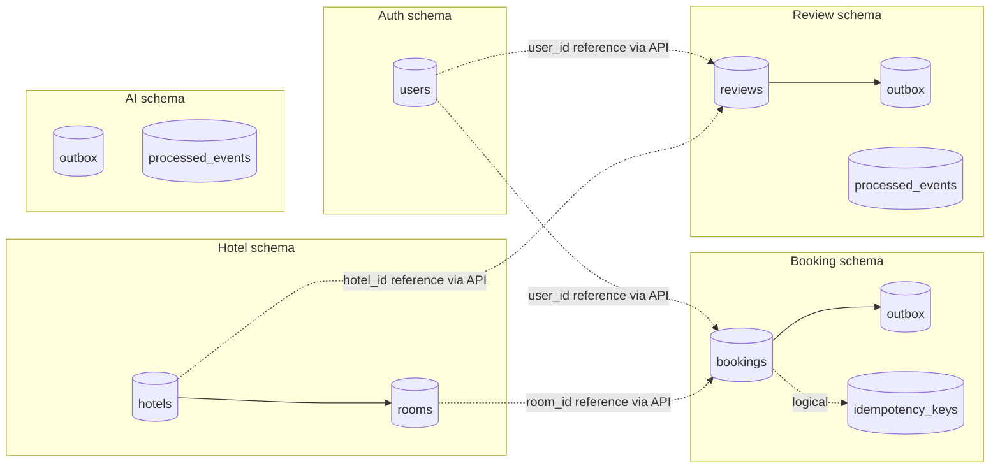

# HotelGenie — 05. Data Design & Resource Mapping

**Mã:** HG-DATA-05 · **Phiên bản:** v1.0 (đề xuất để review) · **Ngày:** 19/11/2026  
**Đầu vào đã đối chiếu:** Project Charter v1.0; SRS v1.0; SAD v1.0; tài liệu 04 API & Event Contracts v1.0; slide SOA B5 (*Data Modeling / Resource Design*), B7 (*Backend Service*) và liên hệ B2–B4, B6, B8, B9.\
**Mục đích:** từ yêu cầu và hợp đồng được thống nhất đến ERD, database schema, ràng buộc và migration **đủ cụ thể để nhóm bắt đầu lập trình**, đồng thời làm rõ đâu là quyết định nhóm chưa duyệt.

> **Trạng thái:** Thiết kế v1.0, chưa được nhóm chính thức phê duyệt. File SQL có thể dùng làm baseline triển khai PostgreSQL; **chưa được xác nhận chạy trên một PostgreSQL thật trong môi trường hiện tại**. Các ví dụ migration không thay thế migration Alembic mà nhóm cần quản lý trong repository.

## 1. Nguyên tắc thiết kế dựa trên slide

Slide **B5** phân biệt ba lớp: **Persistence/DB Schema → Domain Model → API Resource**. API resource có identity, state, representation; không suy ra endpoint bằng cách biến mọi bảng thành API. B5 dạy resource naming, relationships (1–N), nested URL, JSON schema, offset/cursor/keyset pagination và filtering/sorting. Slide **B7** trình bày Flask + SQLAlchemy 2.x, CRUD, tổ chức tầng ứng dụng và migration (Flask-Migrate/Alembic): sửa ORM **không đồng nghĩa** schema database đã tự đổi.

Áp dụng vào HotelGenie:

1. **Persistence:** `auth.users`, `hotel.hotels`, `hotel.rooms`, `booking.bookings`, `review.reviews`, các bảng outbox/idempotency/processed event.
2. **Domain:** `Booking` quản lý tính hợp lệ của thời gian, giá snapshot, trạng thái và quy tắc phòng trống; `Review` có trạng thái kiểm duyệt; `Hotel` quản lý catalog.
3. **API:** `/api/v1/hotels`, `/api/v1/rooms/{id}`, `/api/v1/bookings`, `/api/v1/hotels/{id}/reviews` là resource nghiệp vụ **không hiển thị password_hash, outbox, processed_events hay DB implementation details**.

Một PostgreSQL instance cho demo, **schema tách theo service** là lựa chọn được SAD đề xuất; mỗi service chỉ truy cập tables mình sở hữu. `room_id` ở booking và `hotel_id` ở review là **external reference**: không tạo FK xuyên service, xác thực qua API của owner. Trong mỗi service, FK nội bộ vẫn có thể dùng (Hotel→Room, Review→Review Outbox).

## 2. ERD tổng quan và service data ownership



Sơ đồ chi tiết theo thực thể: [`diagrams/05-er-diagram.mmd`](diagrams/05-er-diagram.mmd) (đường chấm = quan hệ logic không có FK database).

| Schema | Owner service | Bảng | Trách nhiệm | Không được tự làm |
|---|---|---|---|---|
| `auth` | Auth | `users` | tài khoản, hash mật khẩu, role | lưu booking |
| `hotel` | Hotel | `hotels`, `rooms` | catalog, tọa độ, giá niêm yết và sức chứa | xác nhận cuối cùng một booking |
| `booking` | Booking | `bookings`, `idempotency_keys`, `outbox` | booking, snapshot giá, chống đặt trùng, event | đọc SQL trực tiếp `hotel.rooms` |
| `review` | Review | `reviews`, `outbox`, `processed_events` | rating, nội dung, trạng thái moderation | gọi AI đồng bộ để chặn request tạo review |
| `ai` | AI | `outbox`, `processed_events` | đảm bảo event moderation và deduplication | trở thành source of truth phòng/giá |

**Đề xuất vận hành:** nên tạo DB role riêng, chỉ cấp quyền schema tương ứng, dù chung một PostgreSQL instance. File baseline sử dụng quyền migration owner; phân quyền sẽ bổ sung ở cấu hình deployment sau khi chốt tên DB roles.

## 3. Data dictionary — thực thể lõi

Các trường dưới đây khớp với OpenAPI 04; trường có dấu `*` là nội bộ, **không mặc định trả qua REST**.

### 3.1. Auth / `auth.users`

| Trường | Kiểu DB | Ràng buộc | Ghi chú |
|---|---|---|---|
| `id` | UUID | PK | cùng dạng UUID với `User.id` |
| `email` | varchar(255) | not null, unique case-insensitive (index `lower(email)`) | normalize tại application |
| `full_name` | varchar(120) | not null | `User.full_name` |
| `password_hash`* | text | not null | không trả ra API/log |
| `role` | varchar(24) | `customer/admin` | admin là khả năng hỗ trợ; UI admin không thuộc P0 |
| `active`* | boolean | default true | cho phép vô hiệu hóa |
| `created_at`, `updated_at`* | timestamptz | not null | lưu UTC tại app |

### 3.2. Hotel / `hotel.hotels`, `hotel.rooms`

| Bảng | Trường quan trọng | Ràng buộc |
|---|---|---|
| `hotels` | id, name, city, address, latitude, longitude, description, active* | PK UUID; lat −90..90, lng −180..180; index city khi active |
| `rooms` | id, hotel_id, name, capacity, price_per_night_vnd, active | FK **nội bộ** `rooms.hotel_id → hotels.id`, capacity 1..20, giá ≥ 0, index theo hotel/price |

**Mô hình chọn cho MVP (SAD ADR-01, chưa duyệt):** một record `room` là **một phòng vật lý**, không phải loại phòng với inventory số lượng. Không có bảng `room_types` hoặc `inventory` trong v1.0; nếu đổi phải cập nhật SRS, API và test đồng thời.

### 3.3. Booking / `booking.bookings`

| Trường | Kiểu DB | Ràng buộc / ý nghĩa |
|---|---|---|
| `id` | UUID | PK |
| `user_id` | UUID | external Auth ID, **không FK** |
| `room_id` | UUID | external Hotel ID, **không FK** |
| `check_in`, `check_out` | DATE | `check_out > check_in`; checkout **không tính là đêm ở** |
| `guests` | smallint | 1..20; capacity phải kiểm tra từ Hotel booking snapshot |
| `price_per_night_vnd`* | bigint | snapshot giá, ≥0 |
| `total_price_vnd` | bigint | số đêm × snapshot giá (demo chưa có phí khác) |
| `status` | varchar(24) | `confirmed`, `cancelled` |
| `created_at` | timestamptz | thời điểm tạo |
| `cancelled_at`* | timestamptz | chỉ có khi cancelled |

Điểm quan trọng: **Hotel cung cấp giá niêm yết**, nhưng **Booking lưu bản chụp giá tại lúc tạo**; giá phòng thay đổi sau đó không làm biến đổi booking lịch sử. `Booking.total_price_vnd` trong response lấy từ bản ghi booking, không truy vấn giá hiện tại.

### 3.4. Review / `review.reviews`

| Trường | Kiểu DB | Ràng buộc / ý nghĩa |
|---|---|---|
| `id` | UUID | PK |
| `user_id`, `hotel_id` | UUID | external refs (Auth/Hotel), không FK |
| `rating` | smallint | 1–5 |
| `content` | text | 1–3000 ký tự sau trim (khớp `ReviewRequest.content` trong OpenAPI) |
| `submission_version`* | int | ≥1, dùng chặn moderation kết quả cũ |
| `moderation_status` | varchar(24) | `pending/approved/flagged/rejected` |
| `sentiment`* | varchar(12) | positive/neutral/negative hoặc NULL |
| `moderation_reason`* | text | lý do AI, có thể cần ẩn ở API công khai |
| `created_at`, `moderated_at`* | timestamptz | audit |

Review mới luôn là `pending`. Query công khai chỉ lấy `approved`; kết quả moderation có `submission_version` trùng phiên bản hiện tại mới được cập nhật.

## 4. Booking concurrency — bắt buộc hiểu đúng

Giả sử A và B cùng gọi `POST /api/v1/bookings` cho `room_id=X` và các ngày giao nhau. Việc cả hai đều GET thấy phòng trống **không đủ** để đảm bảo dữ liệu đúng.

**Đề xuất ràng buộc DB (bổ sung ngoài ví dụ slide B5):** PostgreSQL extension `btree_gist` và exclusion constraint:

```sql
CONSTRAINT no_overlapping_confirmed_booking EXCLUDE USING gist
 (room_id WITH =, daterange(check_in, check_out, '[)') WITH &&)
 WHERE (status = 'confirmed')
```

- `[)` nghĩa là ngày check-in được tính, ngày check-out không tính; hai booking `[01,03)` và `[03,05)` **không xung đột**.
- Chỉ booking `confirmed` chặn phòng; booking `cancelled` được loại khỏi ràng buộc.
- Hai giao dịch insert cùng lúc: PostgreSQL bảo đảm tối đa một được commit nếu khoảng ngày giao nhau.
- Bắt `IntegrityError` đúng tên constraint hoặc SQLSTATE `23P01`, rollback và map thành HTTP `409 BOOKING_CONFLICT`; không biến mọi lỗi DB thành 409.
- Availability lookup ở `POST /internal/v1/availability/check` chỉ là snapshot cho tìm kiếm; **điểm chặn cuối cùng nằm tại insert booking**.

```mermaid
sequenceDiagram
  participant C as Client
  participant B as Booking Service
  participant H as Hotel Service
  participant DB as PostgreSQL booking schema
  C->>B: POST /bookings + JWT + Idempotency-Key
  B->>H: GET room booking-snapshot (REST)
  H-->>B: active, capacity, price_per_night_vnd
  B->>B: Validate dates/guests, calculate total
  B->>DB: BEGIN + reserve idempotency key
  B->>DB: INSERT confirmed booking
  alt no overlap
    B->>DB: INSERT booking.created into outbox
    B->>DB: Link idempotency to booking; COMMIT
    B-->>C: 201 booking
  else exclusion conflict
    B->>DB: ROLLBACK
    B-->>C: 409 BOOKING_CONFLICT
  end
```

**Rủi ro cần ghi nhận:** snapshot giá/sức chứa có thể thay đổi sau REST call đến Hotel. Demo chấp nhận snapshot theo thời điểm request; production cần version/lease hoặc hợp đồng đặt phòng chặt hơn. Không khẳng định giao dịch phân tán giữa 2 service là atomic.

## 5. Idempotency của POST booking

Bảng `booking.idempotency_keys` khóa theo `(user_id, route, idempotency_key)`; lưu thêm `request_hash` (SHA-256 của body chuẩn hóa), `booking_id`, `response_status`.

1. JWT xác định `user_id`, không nhận `user_id` từ body client.
2. Cùng key + cùng body đã commit → trả cùng booking/response ổn định, không insert lần hai.
3. Cùng key + khác body → `409` do key reuse sai.
4. Hai request cùng key chạy đồng thời: **unique PK** buộc serial hóa việc tạo bản ghi key; application cần dùng `INSERT ... ON CONFLICT` + đọc lại record sau khi giao dịch đầu kết thúc; không dùng `SELECT` rồi `INSERT` thiếu khóa.
5. Nếu booking insert thất bại thì rollback cả key reservation trong cùng transaction; policy lưu kết quả lỗi 409 hay không sẽ chốt ở service.
6. Cần chuẩn hóa hash (ví dụ JSON canonical, cùng encoding), giới hạn chiều dài key; phải xác định retention/cleanup sau demo.

**Không ghi response bí mật** vào bảng idempotency. V1.0 chọn giữ booking ID + status; khi replay lấy booking từ DB. Không hứa chính xác từng byte response có timestamp/headers giống trước.

## 6. Cập nhật/hủy booking nguyên tử

Theo Contract 04: `PATCH /api/v1/bookings/{booking_id}` với `{"status":"cancelled"}`.

- Owner lấy từ JWT đã kiểm tra, query `WHERE id = :id AND user_id = :jwt_user` để tránh đọc/sửa booking người khác.
- Trong cùng transaction: `UPDATE ... SET status='cancelled', cancelled_at=now() WHERE id=:id AND user_id=:user AND status='confirmed' RETURNING id`, sau đó insert `booking.cancelled` vào outbox rồi COMMIT.
- Nếu bản ghi đã cancelled, **không phát event lần hai**. HTTP status cho hủy lặp (`200` hay `409`) phải khớp Contract 04; phiên bản này chưa tự ấn định.
- Kiểm tra chính sách không cho hủy sau check-in (DEC-04) tại service trước update; **chưa chốt** timezone/ngày giới hạn.

## 7. Redis Streams, outbox và deduplication

### 7.1. Tại sao cần outbox?
Nếu `COMMIT booking` xong rồi Redis lỗi, publish trực tiếp có thể làm **mất event**. Do đó trong **một transaction local**, ghi booking và `booking.outbox` đồng thời. Worker riêng poll outbox → publish Redis Streams → mark `published_at` sau khi Redis xác nhận.

**Giới hạn có chủ đích:** Hệ thống hướng tới **at-least-once delivery**, không thể mặc định "exactly once". Nếu publish thành công nhưng worker crash trước khi mark, event có thể bị publish lại. Consumer phải idempotent bằng `event_id`.

### 7.2. Các bảng kỹ thuật

| Bảng | Mục đích | Điểm khóa |
|---|---|---|
| `booking.outbox` | booking.created/cancelled | event UUID PK; index unpublished |
| `review.outbox` | review.submitted | event UUID PK; FK nội bộ tới review |
| `ai.outbox` | review.moderated | event UUID PK; có thể dùng AI DB local |
| `review.processed_events` | dedup review.moderated | PK `(consumer_name,event_id)` |
| `ai.processed_events` | dedup review.submitted | PK `(consumer_name,event_id)` |

**Lưu ý 1:** booking outbox cho phép `aggregate_id=booking.id` nhưng không thêm FK cưỡng bức để giảm coupling của worker migration; vẫn phải bảo toàn bằng code/tests.  
**Lưu ý 2:** `review.processed_events` và cập nhật review thực hiện **cùng một transaction local**; nếu insert dedup rồi cập nhật review thất bại phải rollback cả hai.  
**Lưu ý 3:** AI service chỉ cần SQL schema nếu chọn đảm bảo outbox/dedup bền vững; bản này chọn có, vì pipeline review bất đồng bộ nằm trong P0.

### 7.3. Luồng moderation

```mermaid
sequenceDiagram
  participant R as Review Service
  participant DB as Review DB
  participant S as Redis Streams
  participant A as AI Worker
  participant AD as AI DB
  R->>DB: BEGIN; INSERT pending review + review.outbox; COMMIT
  R-->>S: Outbox publisher XADD review.submitted
  S->>A: XREADGROUP review.submitted
  A->>AD: Check/insert processed(event_id)
  A->>A: Gemini moderation (or test mock)
  A->>AD: INSERT ai.outbox review.moderated; COMMIT
  A->>S: XACK submission (on durable commit)
  S->>R: XREADGROUP review.moderated
  R->>DB: BEGIN + dedup event_id + update if submission_version matches
  R->>DB: COMMIT
  R->>S: XACK moderation event
```

**Điều kiện code cần làm:** Khi AI provider lỗi, không ghi processed success và không ACK thành công; có retry policy/cơ chế reclaim pending. Worker thực tế phải phân biệt trạng thái “đang xử lý” và “đã xử lý” khi có nhiều consumer. Thực hiện AI call **ngoài** giao dịch DB giữ khóa dài; sau đó dùng transaction ngắn để ghi processed + outbox. Chi tiết retry/DLQ là phần của Implementation/Testing.

## 8. Mapping API ↔ domain ↔ persistence (minh chứng B5)

| REST resource / sự kiện | Domain operation | Bảng nguồn | Chú ý response |
|---|---|---|---|
| `POST /api/v1/auth/register` | Create user | auth.users | không trả `password_hash` |
| `GET /api/v1/users/me` | Get identity | auth.users | chỉ field public User |
| `GET /api/v1/hotels` | Search catalog | hotel.hotels (+ rooms, availability API khi có dates) | `HotelList`, pagination |
| `GET /api/v1/hotels/{id}/rooms` | List hotel rooms | hotel.rooms | `RoomList`, pagination |
| `GET /api/v1/rooms/{id}` | Room details | hotel.rooms | `Room` DTO |
| `GET /internal/v1/rooms/{id}/booking-snapshot` | Supply booking snapshot | hotel.rooms | chỉ cần id, hotel_id, active, capacity, price |
| `POST /internal/v1/availability/check` | Batch availability | booking.bookings | không tự hỏi lại Hotel (tránh vòng gọi) |
| `POST /api/v1/bookings` | Confirm booking | booking.bookings, idempotency_keys, outbox | `Booking`; `201` hoặc 409 |
| `GET /api/v1/bookings` | List owner's bookings | booking.bookings | filter user_id từ JWT, không từ query |
| `PATCH /api/v1/bookings/{id}` | Cancel booking | booking.bookings, outbox | trạng thái nhất quán |
| `POST /api/v1/reviews` | Submit pending | review.reviews, outbox | `Review` pending |
| `GET /api/v1/hotels/{id}/reviews` | List approved reviews | review.reviews | filter moderation_status=approved |
| `POST /api/v1/ai/searches` | NL → filters → catalog | không bắt buộc lưu prompt/DB | DTO filters + real rooms |
| `GET /api/v1/hotels/{id}/nearby-places` | Provider adapter | provider/seed data (không phải table khách sạn) | `source`, `is_fallback` |

### 8.1. Pagination/filtering

Contract 04 sử dụng metadata `page`, `per_page`, `total`, `total_pages` → triển khai **offset pagination** ở MVP, không âm thầm đổi cursor. Query có `ORDER BY` ổn định, ví dụ `(created_at DESC,id DESC)` hoặc `(price_per_night_vnd ASC,id ASC)`; `LIMIT` bounded. Offset phù hợp dữ liệu demo, nhưng độ trễ và tính nhất quán khi dữ liệu lớn kém hơn keyset (B5). Khi thêm cursor/keyset phải version/update contract.

### 8.2. Quan hệ API và DB

- `/hotels/{hotel_id}/rooms` là nested resource vì quan hệ 1–N **nội bộ Hotel**.
- `/bookings` là top-level business resource, không đưa dưới `/users/{id}/bookings` để tránh dùng URL như cơ chế phân quyền; ownership lấy từ JWT.
- `outbox`, `idempotency_keys`, `processed_events` **không có public REST resource**.
- Field `available` nếu xuất hiện ở API phải được xác minh bằng Booking availability cho ngày cụ thể, không suy ra từ `rooms.active`.

## 9. Migration, quyền truy cập và seed

### 9.1. Bộ file kèm theo

| File | Vai trò |
|---|---|
| `data-design/001_initial.sql` | Tạo 5 schemas, thực thể, indexes, constraints và kỹ thuật outbox/dedup |
| `data-design/002_demo_seed.sql` | 2 khách sạn giả lập và 3 phòng; tên có “Demo” tránh nhầm với dữ liệu thật |
| `diagrams/05-er-diagram.mmd` | ERD chi tiết, phân biệt FK vật lý và external references |

### 9.2. Chạy thử PostgreSQL (sau khi cài PostgreSQL / Docker)

```bash
# Chạy theo thứ tự với thông tin đăng nhập từ môi trường demo
psql "$DATABASE_URL" -v ON_ERROR_STOP=1 -f docs/data-design/001_initial.sql
psql "$DATABASE_URL" -v ON_ERROR_STOP=1 -f docs/data-design/002_demo_seed.sql
```

Không nhúng username/password thật vào repo. Khi tích hợp Flask, tạo migration tương ứng trong **mỗi service** bằng Alembic/Flask-Migrate; đối chiếu script baseline với migration generated và **viết tay** phần extension/exclusion/index đặc biệt. Không chạy baseline SQL và Alembic bootstrap chồng nhau trên cùng một DB mà không có quy trình stamp/baseline rõ ràng.

### 9.3. Test SQL bắt buộc trên PostgreSQL thật

1. Insert 1 booking `[2026-12-01,2026-12-03)` confirmed cho room A → thành công.
2. Insert tiếp `[2026-12-02,2026-12-04)` confirmed room A → lỗi exclusion `23P01`.
3. Insert `[2026-12-03,2026-12-05)` confirmed room A → thành công (liền ngày checkout).
4. Chuyển booking đầu thành cancelled kèm `cancelled_at`, sau đó chèn lại đúng khoảng đầu → thành công nếu không xung đột booking khác.
5. Đặt đồng thời 2 transaction tranh cùng room + date → nhiều nhất 1 commit.
6. Hai request cùng `Idempotency-Key`: cùng body → 1 booking; khác body → 409.
7. Cập nhật review bằng event 2 lần → chỉ 1 lần tác động, review pending không public.
8. Chạy migration/seed trên PostgreSQL trống, rồi query từng schema và dùng EXPLAIN cho truy vấn lọc chính.

**Chưa báo cáo các test trên là PASS**; đây là checklist bắt buộc khi chạy prototype.

## 10. Rà soát nhất quán và quyết định mở

| ID | Quyết định | Trạng thái | Hệ quả nếu thay đổi |
|---|---|---|---|
| DD-01 | Một `room` là một phòng vật lý | Đề xuất, theo SAD ADR-01 | thay booking/availability constraint |
| DD-02 | Booking status `confirmed/cancelled` | Đề xuất | thay DB check/state machine |
| DD-03 | Giá demo VND, không thu phí, snapshot tại booking | Đề xuất | thay total-price formula |
| DD-04 | Auth email case-insensitive unique | Đề xuất | review auth normalization |
| DD-05 | Schema riêng theo service trên một instance | Theo SAD, cần duyệt | tách DB/roles/migration |
| DD-06 | Outbox durable cho Booking, Review, AI | Đề xuất | worker, retry, data ownership |
| DD-07 | Được phép review khi nào / 1 review mỗi booking? | **Chưa chốt** | chưa thêm booking_id/unique constraint vào review |
| DD-08 | Booking có được hủy sau check-in? | **Chưa chốt** | thay rule service và kiểm thử |
| DD-09 | Live Places provider và cache | **Chưa chốt** | v1.0 không thêm places table |
| DD-10 | Retention idempotency/outbox/events | **Chưa chốt** | cần cleanup/monitoring |
| DD-11 | JWT RS256 hay HS256 | **Chưa chốt** | không tác động schema users cơ bản |

### 10.1. Các giới hạn/điểm chưa giải quyết

- **Cross-service existence:** không thể đảm bảo referential integrity vật lý cho external UUID bằng SQL FK; cần validate qua REST, audit và hạn chế hard delete.
- **Review owner:** nếu yêu cầu chỉ review sau booking `completed`, hệ thống hiện không có trạng thái `completed`; phải thống nhất thêm rule và endpoint xác minh (không tự thêm FK cross-service).
- **Review moderate schema:** event `review.moderated` có `submission_event_id`/`submission_version`; consumer phải kiểm tra version, không chấp nhận kết quả cũ.
- **AI/Places:** không persist prompt hoặc dữ liệu live trong MVP để giảm dữ liệu nhạy cảm và stale cache; có thể thêm sau khi xét nhu cầu.
- **DB permission:** baseline chưa tự tạo role và GRANT vì chưa quyết định tên runtime identities.
- **Test limitation:** baseline SQL cần được chạy trên PostgreSQL thật; lint/tĩnh không thay thế kiểm chứng SQL runtime.

## 11. Truy vết SRS, SAD, Contract và slide

| Yêu cầu | Quyết định dữ liệu | Hợp đồng 04 | Bài SOA / minh chứng |
|---|---|---|---|
| FR-AUTH-01..04 | auth.users, email unique, password_hash | register/token/me | B6 JWT/AuthZ, B7 SQLAlchemy |
| FR-HOTEL-01..06 | hotel.hotels/rooms, city/capacity/price indexes | hotels/rooms APIs | B5 resource ≠ DB, filtering/pagination |
| FR-BOOK-01..06 | bookings + EXCLUDE + idempotency + outbox | bookings CRUD, booking events | B2 HTTP 201/409, B3 idempotency, B7 transactions |
| FR-REV-01..06 | reviews + outbox + processed_events | reviews and moderation events | SOA async, B8 event replay test |
| FR-AI-01..04 | AI stateless filter, no hotel data owner | AI searches | B5 DTO contract; B4 OpenAPI |
| FR-PLACE-01..05 | Hotel lat/long; provider DTO, no live places DB | nearby-places | B5 representation/source metadata |
| FR-SOA-01..06 | ownership; no cross-service FK; versioned schema | OpenAPI + event schemas | B1–B9, explicit B9 `/api/v1` |

## 12. Definition of Ready để bắt đầu code

- [ ] Nhóm duyệt DD-01..03 và chính sách review/hủy tối thiểu.
- [ ] SQL baseline chạy sạch trên PostgreSQL mới; kiểm tra `no_overlapping_confirmed_booking` tồn tại.
- [ ] Đối chiếu OpenAPI DTO với các models; **không expose DB model trực tiếp**.
- [ ] Chốt quy tắc JWT user ID và quyền user/booking.
- [ ] Thiết kế/triển khai Alembic revisions cho từng service, không chỉ dùng `db.create_all()`.
- [ ] Có contract test booking race/idempotency, review dedup và availability.
- [ ] Có seed catalog deterministic, môi trường demo không phụ thuộc Gemini/Places để chạy test.

**Bước tiếp theo:** Tài liệu **06 – AI Service Specification** (schemas, prompt flow, provider abstraction, moderation/fallback), sau đó **07 – Implementation Plan** để bắt đầu skeleton/prototype song song.
