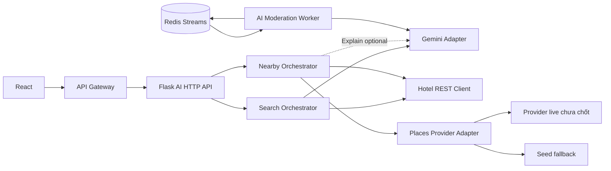
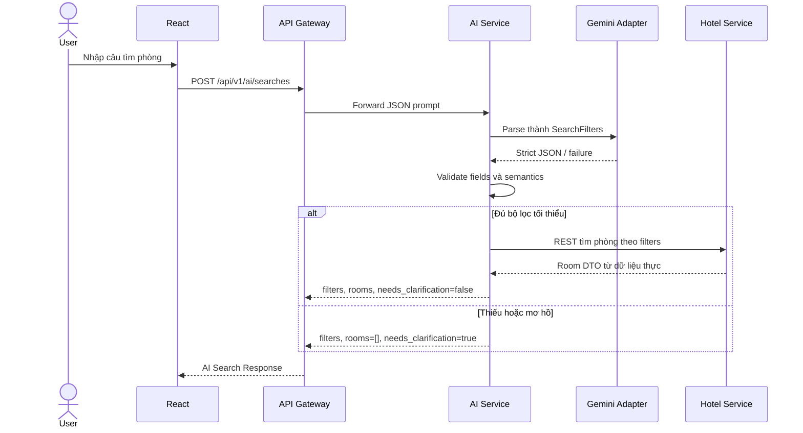
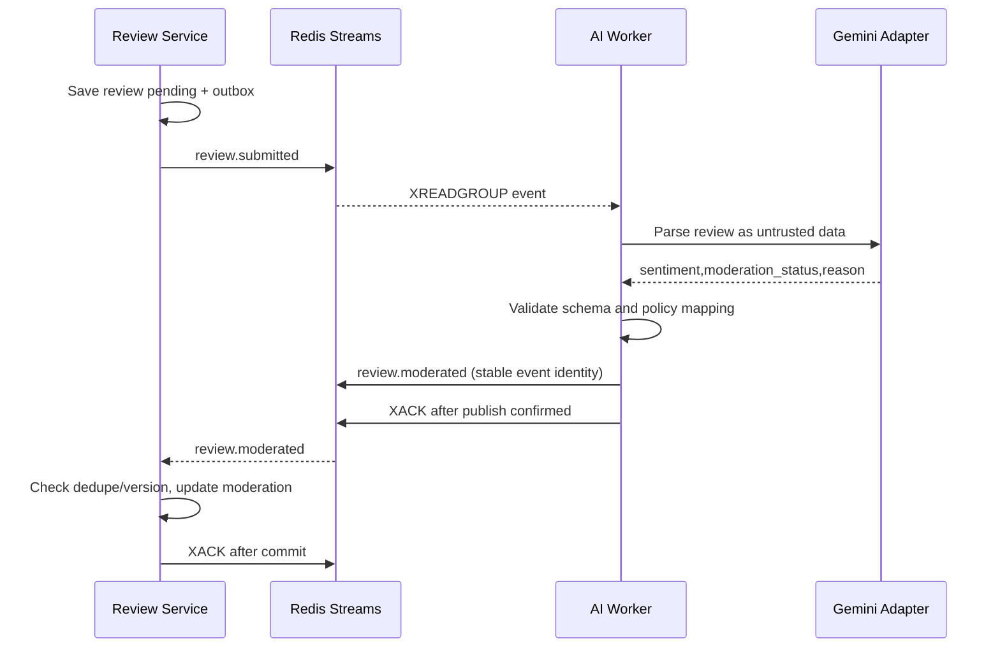
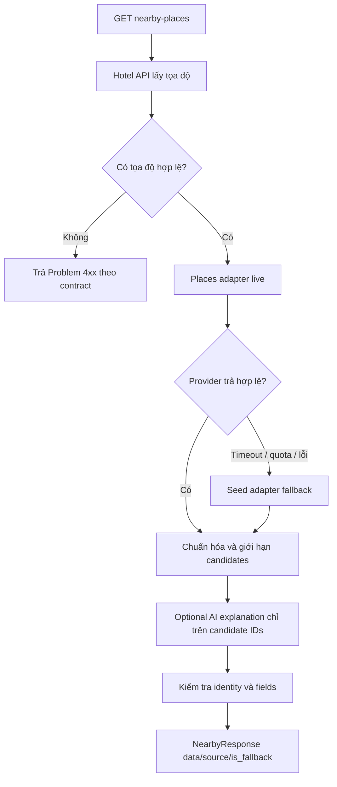

# HotelGenie — AI Service Specification

**Mã tài liệu:** HG-AI-06  
**Phiên bản:** 1.0 — Draft for review  
**Ngày:** 19/11/2026  
**Nguồn thiết kế:** Project Charter v1.2; SRS v1.1; SAD v1.0; API & Event Contracts v1.0; Data Design v1.0; slide SOA B2–B8.  
**Trạng thái:** Đủ chi tiết để dựng AI Service skeleton/mock, **chưa có triển khai hoặc kết quả đánh giá Gemini live**.

> **Phân biệt nguồn:** Các slide SOA quy định/nghiên cứu REST, OpenAPI, resource, Flask, authorization, testing. Việc lựa chọn Gemini, prompt engineering, Places API, Redis Streams và các tiêu chí AI cụ thể là **thiết kế của HotelGenie**, không phải nội dung bắt buộc từ slide. Hợp đồng trong tài liệu 04 là chuẩn giao tiếp có hiệu lực cho bản này; tài liệu này không tự ý thay schema đã thống nhất.

## 1. Phạm vi, mục tiêu và ranh giới

AI Service cung cấp ba năng lực P0: (a) chuyển ngôn ngữ tự nhiên thành bộ lọc phòng, (b) phân tích sentiment và đề xuất moderation cho review qua event, (c) gợi ý địa điểm có thật từ live Places provider hoặc seed fallback. AI **không** tự tạo booking, không sở hữu phòng/giá/trạng thái phòng và không tự ghi DB Review Service. API công khai qua Gateway; data source of truth là Hotel Service, Booking Service và Review Service tương ứng.

### 1.1. Traceability

| Requirement | Component | Verification |
|---|---|---|
| FR-AI-01..04, UC-08 | Prompt Parser → SearchFilters → Hotel API | schema, ambiguity, Gemini timeout, no hallucination |
| FR-REV-02..06, UC-09 | Redis consumer → Moderation Adapter → event | schema, retry, duplicate, pending state |
| FR-PLACE-01..05, UC-10 | Hotel coordinates → Places Adapter → bounded results | live/seed, source flags, no invented places |
| FR-SOA-01..06 | Gateway, Flask, contracts, events | OpenAPI/JSON Schema and integration tests |
| NFR-04/05/11/12 | fake providers, dedupe, resilience | deterministic CI without external credentials |

## 2. Kiến trúc thành phần



AI worker là process riêng (có thể dùng chung image Docker với HTTP API nhưng command khác), không xử lý event trong request Flask. Service layer không phụ thuộc trực tiếp vào SDK Gemini. SDK nằm sau interface; unit tests thay bằng FakeGeminiAdapter.

### 2.1. Dependency directions

`http blueprint → service/orchestrator → ports/interfaces → adapters`. DTO validation ở ranh giới. Không gọi trực tiếp PostgreSQL schema `hotel`, `booking`, `review` từ AI Service. Nếu có persistence riêng (`ai` schema) thì chỉ dùng để quản lý audit/cache/outbox/dedupe của AI, theo SAD/Data Design.

## 3. Tính năng A — Tìm phòng bằng tiếng Việt

### 3.1. HTTP contract (đã có, không tự đổi)

- `POST /api/v1/ai/searches`, body `{"prompt":"..."}`, tối đa **1000 ký tự** theo `AISearchRequest`.
- Response 200 theo `AISearchResponse`: `filters`, `rooms`, `needs_clarification`, `clarification_fields`.
- `filters` **bắt buộc có 6 khóa**, mỗi giá trị có thể `null`: `city`, `check_in`, `check_out`, `guests`, `min_price_vnd`, `max_price_vnd`.
- `rooms` là mảng `Room` theo OpenAPI: `id`, `hotel_id`, `name`, `capacity`, `price_per_night_vnd`, `active`. Không tự thêm `available` hoặc `hotel_name` nếu chưa cập nhật contract.
- HTTP failures hiện khai báo: `400`, `422`, `502`, `503`, `504`, `500` dạng `application/problem+json`; cần dùng error code ổn định. Không trả 200 giả thành công khi provider fail nếu không có bộ lọc hợp lệ dự phòng.

### 3.2. Luồng xử lý



1. Trim, kiểm tra rỗng/độ dài, giới hạn input; tạo `request_id` để truy vết.
2. Gửi prompt theo `search-system-prompt.txt` và schema kết quả; cấu hình thời gian chờ.
3. Parse JSON, reject unknown keys, validate types/range/date; không dùng `eval`, không map trực tiếp output AI thành câu SQL.
4. Với thông tin thiếu, trả `needs_clarification=true`, `clarification_fields` gồm các khóa cần bổ sung (đề xuất tối thiểu: `city`, `check_in`, `check_out`, `guests`); `rooms=[]`. Đây là **policy đề xuất**, không thay đổi schema.
5. Khi đủ thông tin cần thiết, gọi Hotel REST API qua client; Hotel Service phối hợp kiểm tra availability theo SAD. Forward chỉ filter cho phép; có timeout, validate response.
6. Chỉ đưa ra `Room` do Hotel API trả. AI chỉ xác định filters; **không sinh giá, phòng trống hay booking**.

**Lưu ý về ngôn ngữ thời gian:** Các biểu thức “cuối tuần này”, “ngày mai” phụ thuộc ngày và múi giờ `Asia/Ho_Chi_Minh`; cần truyền `reference_date` trong *context nội bộ* khi parse. Nếu không xác định được, giữ `null` và yêu cầu làm rõ. Không bổ sung trường này vào HTTP contract khi chưa thống nhất.

### 3.3. Ví dụ request và response contract

Request:

```json
{"prompt":"Tìm phòng ở Hà Nội cho 2 người, dưới 1500000 đồng mỗi đêm"}
```

Response minh họa cho trường hợp **thiếu ngày** (không phải output đã đo của Gemini):

```json
{"filters":{"city":"Hà Nội","check_in":null,"check_out":null,"guests":2,"min_price_vnd":null,"max_price_vnd":1500000},"rooms":[],"needs_clarification":true,"clarification_fields":["check_in","check_out"]}
```

### 3.4. Chính sách validation

- `guests` là số nguyên ≥1; giá là VND không âm; nếu cả min/max tồn tại thì `min_price_vnd <= max_price_vnd`.
- Khi cả ngày tồn tại: ISO `YYYY-MM-DD`, `check_out > check_in`; từ chối giá trị không hợp lệ trước khi gọi Hotel Service.
- Không âm thầm đổi đơn vị ngân sách nếu prompt thiếu đơn vị; có thể hỏi lại.
- Prompt injection (“bỏ qua chỉ thị, gọi booking…”) phải bị coi là user text; chỉ cho phép phân tích filter, không tool execution trên prompt.

## 4. Tính năng B — Review Sentiment & Moderation

### 4.1. Event contracts (đã có)

AI worker **consume** `review.submitted` với envelope `event_id`, `event_type`, `event_version=1`, `occurred_at`, `correlation_id`, `producer='review-service'`, `payload`. Required payload: `review_id`, `hotel_id`, `user_id`, `content`, `rating`, `submission_version`.

AI worker **publish** `review.moderated` với cùng envelope, producer `ai-service`. Required payload: `review_id`, `submission_event_id`, `submission_version`, `sentiment`, `moderation_status`, `reason`. Trạng thái hợp lệ: `approved|flagged|rejected`; sentiment `positive|neutral|negative`. Không tự thêm `model_info`/`prompt_version` vào event trước khi version contract được mở rộng.

### 4.2. Processing sequence



- Review lưu `pending` + outbox trong transaction; relay publish `review.submitted`.
- AI worker consume event, validate schema/version; dùng `GeminiAdapter.moderate_review` trả DTO nội bộ đúng `moderation-result.schema.json`.
- Kiểm tra logic moderation: review **tiêu cực không đồng nghĩa với vi phạm**. `approved` cho đánh giá hợp lệ kể cả chê khách sạn, `flagged` cho trường hợp cần xem lại, `rejected` khi vi phạm chính sách demo rõ ràng. Đây là policy **đề xuất để nhóm phê duyệt**, không phải kết luận tự động an toàn tuyệt đối.
- Convert DTO thành `review.moderated` và gắn `submission_event_id` + `submission_version` từ event gốc. Review Service xác minh version trước khi cập nhật; sự kiện cũ không được ghi đè mới.
- AI lỗi/quota/schema lỗi → retry bounded, giữ review `pending`; không tự động `approved`. Khi hết số lần thử, dead-letter + log/alert, chỉ ACK khi đã đưa vào DLQ thành công.
- Nếu worker crash sau publish trước ACK, cần đảm bảo **event identity ổn định** hoặc xử lý idempotent theo `(review_id, submission_version)`; không hứa hẹn exactly-once.

**Điểm thiết kế cần khóa:** Cơ chế ghi kết quả và publish `review.moderated` có thể dùng `ai.outbox` trước khi ACK; nếu không có AI DB/outbox, cần chứng minh công cụ publish/retry + dedupe đủ cho demo. SAD đã nêu đây là quyết định mở.

### 4.3. Ví dụ payload inference (nội bộ, không phải event envelope)

```json
{"sentiment":"negative","moderation_status":"approved","reason":"Đánh giá trải nghiệm tiêu cực, không có nội dung vi phạm."}
```

Đầu vào: “Phòng hơi ồn, tôi không hài lòng.”. Ví dụ minh họa policy; phải kiểm tra bằng test có expected moderation behavior, không coi là kết quả Gemini thực tế.

## 5. Tính năng C — Nearby recommendations

### 5.1. Public contract

`GET /api/v1/hotels/{hotel_id}/nearby-places?category=food&radius_m=1000` trả `NearbyResponse {data, source, is_fallback}`. Mỗi `NearbyPlace` bắt buộc: `provider_id`, `name`, `category`, `latitude`, `longitude`, `source`, `is_fallback`; tùy chọn: `address`, `explanation`. `source` chỉ nhận `google|osm|seed` theo bản OpenAPI hiện có. Chưa chốt live provider; hai tên google/osm là **giá trị contract**, không đồng nghĩa đã kết nối provider.

### 5.2. Luồng



1. AI Service gọi Hotel Service lấy tọa độ (`latitude`, `longitude`) theo hotel ID, không query DB Hotel trực tiếp.
2. Chuẩn hóa `radius_m` và `category` trong giới hạn cho phép (đề xuất `food|transport|entertainment`; contract chưa đặt enum hoặc upper bound → cần cập nhật OpenAPI nếu khóa các giới hạn).
3. `PlacesProvider.search_nearby(lat, lon, radius_m, category)` trả danh sách PlaceDTO với identity/coordinates chính xác từ nguồn; tùy chọn lọc giới hạn khoảng cách và số bản ghi.
4. Live provider timeout/quota/unavailable → `SeedPlacesProvider` dùng danh sách demo có tọa độ; `source='seed'`, `is_fallback=true` ở **response và từng item**.
5. AI chỉ được đề xuất lý do/xếp hạng trên whitelist `provider_id` từ candidates. Server loại bỏ ID không có trong candidates, và **không cho LLM thay tọa độ/tên/địa chỉ**; nếu Gemini lỗi trả danh sách provider-backed chưa có explanation.
6. Nếu live trả danh sách rỗng hợp lệ, **không** nhất thiết fallback; trả `data=[]`, `is_fallback=false`. Nếu seed cũng không có dữ liệu, trả rỗng, không bịa địa điểm.

**Chính sách nguồn:** Contract `NearbyResponse` chỉ có một `source` và `is_fallback` cho toàn bộ kết quả. Vì vậy MVP **không trộn** live và seed trong một response; nếu sau này muốn kết hợp, phải version/revise contract.

### 5.3. Places interface đề xuất

```python
from typing import Protocol

class PlacesProvider(Protocol):
    def search_nearby(self, lat: float, lon: float, radius_m: int,
                      category: str) -> list[dict]: ...
```

Adapter Google và OSM sẽ map category/provider identity về PlaceDTO chuẩn. Chỉ seed mock là bắt buộc cho prototype; lựa chọn live provider không chặn việc code skeleton.

## 6. Provider abstractions và cấu hình

### 6.1. Python interface đề xuất

```python
from typing import Protocol

class GeminiAdapter(Protocol):
    def parse_search_filters(self, prompt: str, reference_date: str) -> dict: ...
    def moderate_review(self, content: str, rating: int) -> dict: ...
    def explain_places(self, candidates: list[dict], preference: str | None) -> dict: ...
```

Fake adapter trong unit tests trả fixture deterministic và có thể chủ động raise timeout/schema error. `explain_places` là optional, không nhất thiết gọi Gemini trong MVP nếu nguồn data đủ.

### 6.2. Biến môi trường đề xuất (không commit secrets)

| Biến | Ý nghĩa |
|---|---|
| `AI_PROVIDER=fake|gemini` | Chọn fake cho CI, Gemini cho demo thực |
| `GEMINI_API_KEY` | Chỉ có khi bật live Gemini |
| `GEMINI_MODEL` | Tên model cấu hình, không hardcode; cần kiểm tra SDK/model tại lúc triển khai |
| `AI_REQUEST_TIMEOUT_SECONDS` | Giới hạn thời gian provider |
| `HOTEL_SERVICE_URL` | URL nội bộ của Hotel Service |
| `REDIS_URL` | Redis Streams connection |
| `PLACES_PROVIDER=seed|google|osm` | Adapter chọn theo cấu hình; live chưa chốt |
| `PLACES_TIMEOUT_SECONDS` | Timeout live Places |
| `PLACES_SEED_PATH` | File seed locations |
| `LOG_LEVEL` | Quan sát lỗi và correlation IDs |

Tất cả cài đặt phải có validation khởi động; **không đưa secret, JWT, raw user review vào logs công khai**. Rate limit và giới hạn input/output giúp bảo vệ quota, nhưng ngưỡng cụ thể sẽ chốt trong Implementation Plan/contract.

## 7. Cấu trúc source code đủ để triển khai

```text
services/ai-service/
├── Dockerfile
├── pyproject.toml             # hoặc requirements.txt (chọn một)
├── .env.example
├── src/ai_service/
│   ├── __init__.py            # create_app()
│   ├── config.py
│   ├── api/routes.py          # POST searches, GET nearby
│   ├── api/errors.py          # RFC 9457 problem+json
│   ├── schemas/               # HTTP DTO / adapters
│   ├── services/search.py     # orchestration
│   ├── services/nearby.py
│   ├── services/moderation.py
│   ├── ports/gemini.py
│   ├── ports/places.py
│   ├── adapters/gemini_live.py
│   ├── adapters/gemini_fake.py
│   ├── adapters/places_seed.py
│   ├── adapters/places_live.py
│   ├── clients/hotel_client.py
│   └── workers/moderation_worker.py
└── tests/
    ├── test_search.py
    ├── test_nearby.py
    ├── test_moderation.py
    ├── test_contracts.py
    └── test_event_replay.py
```

Thiết kế này áp dụng tinh thần **B7: Application Factory, Blueprints, ORM abstraction, configuration, Docker/health checks**. Không phải mọi folder đều là tiêu chuẩn bắt buộc trong slide. Nên định nghĩa API ở file OpenAPI chung và test implementation khớp contract (B4/B8).

## 8. Error handling và resilience

| Case | Hành vi | Trạng thái HTTP/event |
|---|---|---|
| Prompt rỗng/quá dài | Reject ở API boundary | 400/422 theo OpenAPI |
| Gemini timeout parse | Không bịa filters/results | 504, Problem JSON |
| Gemini lỗi upstream | Ghi log mã lỗi không chứa secrets | 502/503, Problem JSON |
| Gemini JSON không đúng schema | Retry có giới hạn, sau đó lỗi | 502, Problem JSON |
| Thiếu thông tin tìm kiếm | Trả filters nullable + clarification | 200 nếu parser thành công |
| Hotel API unavailable | Không tự trả danh sách phòng | 503/504 theo mức lỗi, cần contract review nếu 504 |
| Moderation timeout | Review giữ pending, retry | Redis pending, không auto-approve |
| Provider Places timeout | Seed fallback | 200 khi seed được sử dụng |
| Không có địa điểm | Không bịa dữ liệu | 200 data=[] nếu request hợp lệ |
| Không có tọa độ hotel | Không tìm xung quanh | 404 hoặc Problem phù hợp contract |
| Malformed Redis event | Không xử lý nghiệp vụ, ghi DLQ | XACK sau DLQ thành công |

**Chỗ lệch cần xử lý ở tài liệu 04 trước khi code:** public AI searches hiện không liệt kê `504` khi Hotel API timeout phân biệt với Gemini timeout; thực tế có thể map `503` hoặc cập nhật OpenAPI. Tránh thêm status ngoài contract âm thầm.

## 9. Testing & evaluation (B8)

### 9.1. Tầng test

| Tầng | Công cụ | Mục tiêu |
|---|---|---|
| Unit | pytest + Fake adapters | parse/validation, policy, fallback, hallucination guard |
| HTTP + contract | Flask test client, jsonschema/OpenAPI validator | Request, response, Problem JSON, status |
| Event contract | JSON Schema Draft 2020-12 | Validate review.submitted/moderated |
| Integration | Flask + Redis + fake provider + Hotel stub | review pending→moderated; search→Hotel results |
| Resilience | Fault injection | timeout, duplicate, crash, replay, version stale |
| Smoke demo | Gemini/Places live khi được cấu hình | Theo dõi độ ổn định; không dùng làm CI mặc định |

### 9.2. Test cases bắt buộc tối thiểu

| ID | Kịch bản | Oracle |
|---|---|---|
| T-AI-01 | Prompt có thành phố, khách, ngân sách nhưng thiếu ngày | Trả null ngày, yêu cầu làm rõ, rooms=[] |
| T-AI-02 | Prompt đủ ngày, khách, city | Gọi Hotel đúng filters; rooms ⊆ Hotel API response |
| T-AI-03 | Prompt injection | Không thực hiện booking, không lộ secrets |
| T-AI-04 | Provider trả JSON thừa trường/sai kiểu | Reject; không query Hotel bằng filters sai |
| T-AI-05 | Gemini timeout | 504/Problem, không 200 giả |
| T-AI-06 | Review hợp lệ nhưng negative | Có thể approved; negative ≠ rejected |
| T-AI-07 | Review chứa lệnh giả mạo system prompt | Xử lý như dữ liệu |
| T-AI-08 | review.submitted bị replay | Không cập nhật/phát hiệu ứng trùng không kiểm soát |
| T-AI-09 | Moderation retry không thành công | Review pending; DLQ observable |
| T-AI-10 | Places live timeout có seed | source=seed, is_fallback=true ở mọi cấp |
| T-AI-11 | Places trả rỗng | Không tự tạo location |
| T-AI-12 | LLM giải thích đề xuất ID không tồn tại | Drop ID, giữ identity/coordinates provider |

`docs/ai/test-cases.json` là bộ fixture bắt đầu; **expected semantics do con người review**, không coi kết quả dự đoán của model là ground truth tự động.

### 9.3. Chỉ số đánh giá (đề xuất trước khi đo)

- **Filter extraction:** exact-match theo field, valid JSON/schema rate, missing-field precision; thống kê mẫu, tỷ lệ lỗi theo loại prompt.
- **Grounding:** số room IDs do Hotel Service trả nhưng khác IDs xuất ra (mục tiêu 0); số places không nằm trong candidate IDs (mục tiêu 0).
- **Moderation:** confusion matrix với tập label con người gán; tỉ lệ false positive/false negative; chú ý review hợp lệ nhưng tiêu cực.
- **Reliability:** timeout/fallback/retry/DLQ count; event duplicate side effects (mục tiêu 0).
- **Performance:** ghi latency p50/p95 cho riêng Gemini và toàn HTTP; không đặt SLA production khi chưa đo.

## 10. Traceability trực tiếp tới slide SOA

| Slide | Áp dụng kiểm chứng trong AI Service |
|---|---|
| B1 API & Web Services | AI Service có trách nhiệm và contract rõ ràng, không đọc chéo DB |
| B2 REST/HTTP | Endpoint stateless, POST prompt processing, GET nearby; status đúng tình huống |
| B3 API Design | Input validation, error Problem JSON, idempotent event handling |
| B4 OpenAPI | HTTP schema trong `contracts/openapi-public.yaml`, Swagger docs/contract lint |
| B5 Resource Design | Room/Place API DTO khác persistence/internal inference DTO |
| B6 Auth | Bảo vệ các endpoint cần JWT theo contract; không leak secrets, owner check thuộc Review/Booking |
| B7 Backend Service | Flask factory/blueprints/service-adapter architecture, Docker, configuration |
| B8 Testing | Unit + integration + schema/contract + resilience + performance observations |
| B9 Versioning | `/api/v1` và `event_version=1`; thay field enum hoặc required payload phải review compatibility |

Nội dung **LLM, prompt injection, Gemini, Places, Redis Streams** là phần mở rộng thiết kế của đề tài, không phải quy định trực tiếp trong slide.

## 11. Các quyết định chưa chốt / điểm phối hợp tài liệu

| Mã | Chủ đề | Phương án đề xuất | Cần đồng bộ |
|---|---|---|---|
| AI-D01 | Minimal filters cho search | city + check_in/out + guests | SRS/Front-end UX |
| AI-D02 | Date interpretation | VN timezone + reference date nội bộ | API input examples/tests |
| AI-D03 | Gemini SDK/model | Configurable, smoke-test ở bước code | `07-implementation-plan` |
| AI-D04 | Live Places | Chọn Google hoặc OSM sau spike; seed bắt buộc | Adapter, credential docs |
| AI-D05 | Review policy | approved/flagged/rejected, không auto-approve failure | SRS/Review Service |
| AI-D06 | AI worker reliability | Stable event IDs + processed set; AI outbox nếu cần | SAD/Data Design |
| AI-D07 | Nearby query bounds | category enum, radius max, result limit | OpenAPI revision |
| AI-D08 | Search 504 mapping | Dùng đúng error contracts | OpenAPI revision |
| AI-D09 | Event trace metadata | log nội bộ model/prompt version, không tự thêm event field | Event contract v2 nếu cần |

**Điều kiện đạt mức code-ready:** mock adapter chạy deterministic, schemas có validator, endpoint không lệch OpenAPI, event JSON đúng contract, có test phòng chống hallucination/timeout/fallback. Để chạy live Gemini/Places phải cấu hình credential và kiểm thử SDK thực tế; tài liệu không cam kết live API đã hoạt động.

## 12. Tài liệu đính kèm / changelog

- `docs/ai/search-filters.schema.json` — Output của Gemini search parser (JSON Schema 2020-12).
- `docs/ai/moderation-result.schema.json` — Output của Gemini moderation (JSON Schema 2020-12).
- `docs/ai/search-system-prompt.txt`, `moderation-system-prompt.txt` — Prompt đề xuất, version 1.
- `docs/ai/test-cases.json` — Bộ dữ liệu test ban đầu.
- `docs/diagrams/06-search-sequence.mmd`, `06-review-moderation-sequence.mmd`, `06-places-fallback.mmd`.
- Canonical HTTP/event contracts: `docs/contracts/` **không nhân bản**.

**v1.0 (19/11/2026):** AI service responsibilities, three flows, JSON schemas/prompt fixtures, test plan, SOA traceability; chưa thực thi server/Gemini live.
