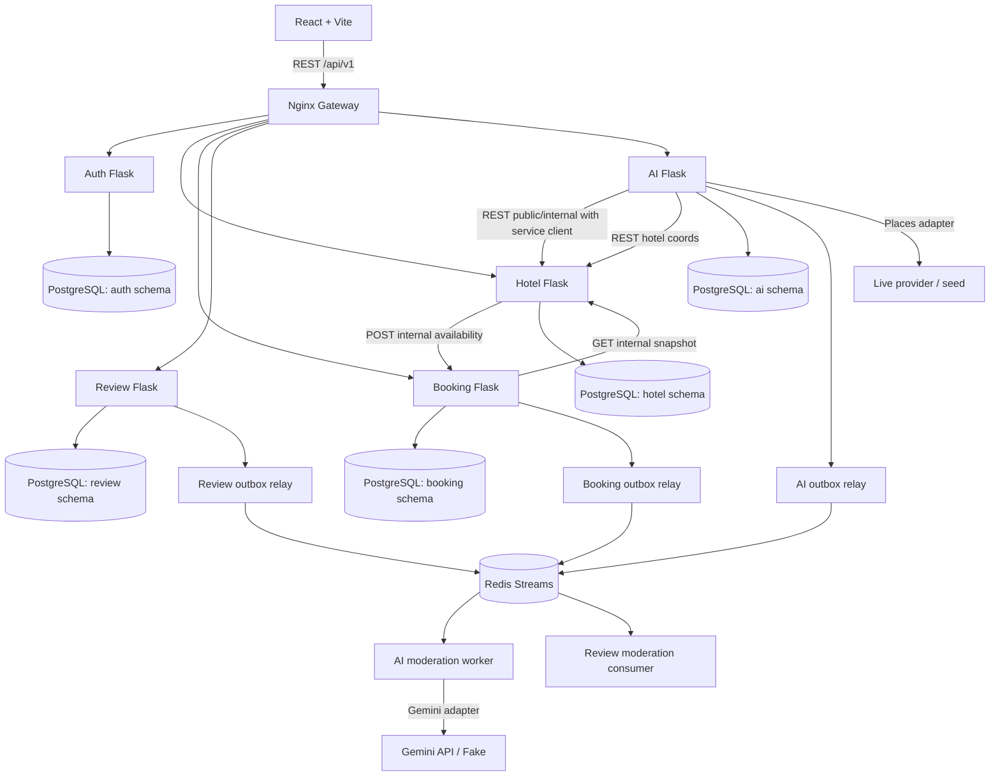
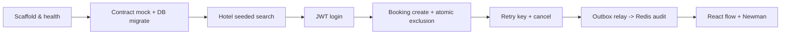

# HotelGenie — 07. Implementation Plan & Prototype Readiness

**Mã:** HG-PLAN-07 · **Phiên bản:** v1.0 DRAFT · **Ngày:** 19/11/2026  
**Nhóm:** 5 thành viên · **Thời gian:** 4 tuần · **Mục tiêu:** triển khai prototype kiểm chứng SOA rồi mở rộng MVP.  
**Nguồn ưu tiên:** Charter v1.2 → SRS v1.1 → SAD v1.0 → API/Event Contracts v1.0 → Data Design v1.0 → AI Specification v1.0; slide SOA B1–B9.  
**Tình trạng:** kế hoạch có thể triển khai sau phiên review/gate; **không khẳng định code, Docker, SQL migration hoặc test đã chạy**.

> **Nguồn vs quyết định dự án:** Các slide dạy nền tảng API/REST, thiết kế resource, OpenAPI, Flask/SQLAlchemy/migration, JWT, testing, versioning. Redis Streams, Gemini, PostgreSQL exclusion constraints, Nginx gateway, outbox và cách chia việc là quyết định/đề xuất **riêng của HotelGenie**, không gán là yêu cầu trực tiếp của slide. Tài liệu 07 không tự sửa các hợp đồng 04.

https://docs.google.com/spreadsheets/d/1K13Q8LpJqMSFI1pLNOEEDfMUOyFNSKop/edit?usp=sharing&ouid=101773319270159752803&rtpof=true&sd=true

## 1. Mục tiêu, phạm vi, cách đo xong việc

1. **Code được:** người mới clone repo có thể bootstrap các service, làm việc theo cùng OpenAPI/event schema và chạy test local.
2. **Tích hợp từ tuần 1:** mỗi nhánh có thể kiểm thử bằng mock/stub trước khi tất cả service sẵn sàng; merge nhỏ và thường xuyên.
3. **Prototype vertical slice:** React → Gateway → Auth/Hotel/Booking → PostgreSQL + Redis: tìm phòng, tạo booking hợp lệ, retry idempotent, thử cạnh tranh đặt trùng, hủy và quan sát booking event.
4. **MVP bổ sung:** Review → Redis → AI moderation, AI prompt search → Hotel data thật, nearby → provider/fallback.
5. **Bằng chứng học phần:** lưu bằng chứng B1–B9 cùng code/spec/test, kết quả chạy thực tế và ảnh/sơ đồ; không ghi PASS khi chưa chạy.

**Phân biệt mức độ hoàn thành:** `Draft` = mô tả; `Ready` = hợp đồng, mock và tiêu chí rõ; `Implemented` = code hoạt động local; `Verified` = test có kết quả thực; `Demoed` = chạy kịch bản tích hợp trên compose. Không coi việc có sơ đồ hay YAML là đã triển khai.

## 2. Thứ tự ưu tiên, ranh giới và nguồn sự thật

| Artifact | Vai trò chuẩn | Đường dẫn |
|---|---|---|
| Charter | Mục tiêu/phạm vi, cách làm song song | `docs/01-project-charter-and-scope.md` |
| SRS | FR/NFR/AT, nghiệp vụ, tiêu chí nghiệm thu | `docs/02-requirements.md` |
| SAD | Ranh giới service, tương tác, ADR | `docs/03-architecture.md` |
| HTTP contract | **Nguồn sự thật đường dẫn, body, response, lỗi** | `docs/contracts/openapi-public.yaml`, `openapi-internal.yaml` |
| Redis event contract | **Nguồn sự thật event name, envelope, payload** | `docs/contracts/events/*.schema.json` |
| Data Design | DB schema/constraints/ownership | `docs/05-data-design.md`, `docs/data-design/` |
| AI spec | Adapter, prompt, fallback, structured output | `docs/06-ai-specification.md`, `docs/ai/` |

**Quy tắc khi có xung đột:** không lặng lẽ chọn một đáp án. Mở issue ghi văn bản, phiên bản, trường/route xung đột, tác động; nhóm duyệt ADR/decision, cập nhật **đồng thời** tài liệu gốc + contract + code/tests, rồi mới merge. Ví dụ `review` ownership hoặc booking cancellation policy chưa chốt phải ghi rõ, không tự nới quyền.

## 3. Kiến trúc triển khai mục tiêu



Các PostgreSQL schema cùng một instance trong demo; boxes là **logical ownership**, không phải năm server DB. Lưu ý Redis Streams không thay thế DB transaction. Internal routes không publish qua public Gateway. Kết nối AI→Hotel cần chọn rõ endpoint/permissions trong 04 trước khi code nếu client không dùng API công khai.

## 4. Cấu trúc repository đề xuất (monorepo)

```text
HotelGenie/
├── README.md
├── .gitignore
├── .env.example                   # Chỉ tên biến/dữ liệu giả
├── compose.yaml
├── Makefile                       # tùy chọn; Windows có scripts/ tương đương
├── frontend/                      # React + Vite
├── gateway/
│   └── nginx.conf
├── services/
│   ├── auth-service/
│   ├── hotel-service/
│   ├── booking-service/
│   ├── review-service/
│   └── ai-service/
├── workers/
│   └── audit-consumer/            # tùy chọn demo booking event
├── docs/
│   ├── 01-project-charter-and-scope.md
│   ├── 02-requirements.md
│   ├── 03-architecture.md
│   ├── 04-api-events.md
│   ├── 05-data-design.md
│   ├── 06-ai-specification.md
│   ├── 07-implementation-plan.md
│   ├── 08-development-testing.md # cập nhật khi code
│   ├── contracts/{events,examples}/
│   ├── data-design/
│   ├── ai/
│   └── diagrams/
├── scripts/
│   ├── bootstrap.cmd
│   ├── smoke.cmd
│   └── seed_demo.py
├── tests/
│   ├── contract/
│   ├── integration/
│   └── e2e/
└── .github/workflows/ci.yml
```

**Template bên trong một Flask service:** `app/__init__.py` (factory `create_app`), `app/api/routes.py` (blueprint), `app/schemas/` (DTO), `app/services/` (business logic), `app/repositories/` (SQLAlchemy), `app/models/`, `app/clients/` (HTTP/Redis adapters), `app/config.py`, `migrations/`, `tests/`, `requirements.txt` (hoặc thống nhất `pyproject.toml`), `Dockerfile`, `wsgi.py`. AI Service tách HTTP process và worker process; code chung nhưng command khác. Lựa chọn exact package manager, driver và factory app được ghi ở PR scaffold, không tự tuyên bố đã chốt.

**Hướng dẫn Windows:** nếu dùng CMD, tạo venv bằng `py -m venv .venv` và `.venv\Scripts\activate.bat` trong thư mục tương ứng; không yêu cầu `source` hay PowerShell activation. Khuyến nghị Docker Compose cho PostgreSQL/Redis để setup đồng nhất; mỗi người có thể chạy Flask local khi debug.

## 5. Bảng module owner và cách phát triển song song

**Nguyên tắc đã chốt:** không phân cứng 1 người = 1 service trong cả dự án. Mỗi work item có **DRI** (người chịu trách nhiệm chính), người hỗ trợ/reviewer có thể đổi hằng tuần. Dưới đây là **đề xuất phân công vị trí TV1–TV5, không gán người thật**.

| Nhóm công việc / đầu ra | DRI ban đầu | Reviewer/backup | Có thể bắt đầu ngay với mock? |
|---|---|---|---|
| Repo scaffold, Compose, Gateway, CI, observability | TV1 | TV5 | Có |
| Auth JWT + user model + owner enforcement helpers | TV2 | TV1 | Có |
| Hotel catalog, filters, availability batch adapter | TV3 | TV4 | Có |
| Booking transaction, exclusion constraint, outbox, idempotency | TV4 | TV3 | Có, mock Hotel snapshot |
| AI Search + Gemini/Places ports, fake adapters | TV5 | TV2 | Có, fake Gemini/Hotel |
| Review API, review outbox/consumer | TV2 | TV5 | Có, fake moderation consumer |
| React pages và API client | TV1 | TV3 | Có, mock OpenAPI |
| Redis worker moderation + AI integration | TV5 | TV2 | Có, fake Gemini |
| Contract/schema tests, Newman, system E2E | **Cả nhóm** | TV1 điều phối | Có |

Không thay owner chỉ bằng nhắn tin: ghi issue, người nhận và trạng thái PR. Thành viên xong một work item hỗ trợ điểm nghẽn chung, không ngồi chờ service phụ trách.

## 6. Gói công việc và phụ thuộc (dùng để tạo GitHub issues)

**Ký hiệu:** `P0` bắt buộc, `P1` tăng cường; `Depends` nghĩa là phụ thuộc **để tích hợp**, không ngăn viết mock trước đó. Bảng máy đọc được có tại `docs/implementation/tasks.csv`.

| ID | Công việc / output có thể kiểm chứng | Owner | Depends | Xong khi... |
|---|---|---|---|---|
| IMP-01 | Repo, env template, PR/CI rules | TV1 | — | Clone, CI lint/test skeleton chạy |
| IMP-02 | Compose: PostgreSQL, Redis, Gateway, services health | TV1 | IMP-01 | `docker compose up --build` và health endpoint trả OK |
| IMP-03 | OpenAPI/event schemas + spec lint CI | TV3 | IMP-01 | Static checks; Spectral/OpenAPI validation được chạy |
| IMP-04 | Auth register/token/me + JWT verification | TV2 | IMP-01,03 | 201/200/401 tests và password hash |
| IMP-05 | Hotel/Room CRUD read + seed/filter/paging | TV3 | IMP-01,03 | Catalog test theo OpenAPI |
| IMP-06 | Booking models/migration, exclusion, idempotency | TV4 | IMP-01,03 | DB-level overlap/replay tests |
| IMP-07 | Internal room snapshot/availability REST | TV3+TV4 | IMP-05,06 | 2 internal operations đúng hợp đồng |
| IMP-08 | POST/GET/PATCH booking + outbox relay | TV4 | IMP-04,06,07 | 201/409/replay/hủy; event publish ổn định |
| IMP-09 | React auth/search/detail/booking + API client | TV1 | IMP-03 | UI gọi mock rồi đổi sang live không sửa contract |
| IMP-10 | Booking event audit demo + smoke E2E | TV1+TV4 | IMP-02,08,09 | Bằng chứng event ID, retry/concurrency |
| IMP-11 | Review API pending/approved + review outbox | TV2 | IMP-04,03 | pending không public, event created |
| IMP-12 | AI Gemini adapter + fake; search orchestrator | TV5 | IMP-03,05 | Prompt→filters→Hotel results, no hallucinations |
| IMP-13 | Review moderation worker + consumer dedupe | TV5+TV2 | IMP-11,12 | submitted→moderated; replay an toàn |
| IMP-14 | Places adapter live/seed + nearby API | TV5 | IMP-03,05 | source và is_fallback chính xác |
| IMP-15 | Newman, unit/contract/integration, Locust optional | Cả nhóm | IMP-04..14 | Báo cáo PASS/FAIL đo thực tế |
| IMP-16 | `/api/v1`→v2 demo + docs/08 + walkthrough | TV1+TV3 | IMP-03,15 | Compatibility check + hướng dẫn chạy/demo |

**Quy tắc chống bế tắc:** đầu tuần mỗi nhóm cung cấp mock server/fake client có response khớp YAML; bên tiêu thụ có thể triển khai ngay mà chưa đợi provider. Việc đóng băng OpenAPI là theo PR và version, không cố tình thay đổi API trong thời gian một sprint nếu chưa báo người dùng.

## 7. Kế hoạch 4 tuần, mục tiêu tích hợp từng tuần

| Tuần | Dòng công việc song song | Checkpoint bắt buộc |
|---|---|---|
| **W1: Ready & skeleton** | TV1 scaffold/Compose/CI; TV2 Auth+Review mock; TV3 Hotel+OpenAPI; TV4 Booking DB/concurrency prototype; TV5 Fake Gemini/Places+AI skeleton; React mock đồng thời | 5 service health (có thể stub), OpenAPI lint, database migrations thử, mock flow xuyên qua Gateway |
| **W2: Core vertical slice** | Auth JWT; Hotel search/filter; Booking create/read/cancel+DB exclusion+outbox; React booking; worker audit events | Demo tìm phòng → login → đặt → hủy; thử booking overlap, retry key, quan sát `booking.created`/`booking.cancelled` |
| **W3: AI + review integration** | Review pending + worker moderation; AI search via Hotel API; Places adapter/seed; contract/integration tests | 3 chức năng AI chạy với fake provider; live provider chỉ bật khi key/quota hợp lệ; Redis review.moderated cập nhật trạng thái |
| **W4: Hardening & report** | Concurrency regression, idempotency replay, provider failure, security/owner checks, E2E, v1/v2 demo, docs/08 | Một lệnh compose khởi chạy; test/log/screenshots thực; walkthrough B1–B9; ghi hạn chế còn tồn tại |

**Kế hoạch dự phòng:** nếu W2 trễ, ưu tiên Auth + Hotel + Booking + event; không hy sinh chống đặt trùng hoặc contract để kịp AI. Nếu live Gemini/Places thiếu quota, **fake adapter chỉ là demo/test**, phải nói rõ không chứng minh được tích hợp live. P1/P2 không cản trở P0.

## 8. Prototype vertical slice — kế hoạch theo các checkpoint thực thi



| Checkpoint | Các thành phần | Cách kiểm chứng và bằng chứng |
|---|---|---|
| P0 | Compose: gateway, 5 Flask service skeleton, Postgres, Redis | Health từ Gateway, container logs, không có secrets trong repo |
| P1 | Contracts và SQL migration | OpenAPI validator/Spectral; chạy migration trên PostgreSQL, query 11 tables; không gọi đây là pass trước khi thực hiện |
| P2 | Seed Hotel + GET list/detail | JSON đúng OpenAPI, filtering/pagination deterministic |
| P3 | Auth + JWT user demo | register/token/me, 401 token invalid, 404 cross-user resource theo contract |
| P4 | Booking create/get/cancel | 201 + Location, 409 overlap, 200 cancel, snapshot VND |
| P5 | Concurrent booking + replay | test 2 request cùng phòng/đêm → ≤1 confirmed; key/body replay → same booking/event |
| P6 | Relay outbox + Redis audit | commit→XADD→consumer; duplicate event không double effect; log correlation_id |
| P7 | React + Newman | UI dùng Gateway; collection có happy/error cases, report có kết quả thật |

**Không lùi invariant:** kiểm tra phòng trống ở Hotel/Booking availability chỉ để hiển thị; insert `booking.bookings` có exclusion constraint mới là quyết định cuối; booking record và outbox cùng transaction. **Không** tạo shared DB ORM giữa service; Booking lấy room snapshot qua HTTP internal, Hotel hỏi Booking availability batch.

## 9. Giao kèo tích hợp chi tiết trước khi code

### 9.1. Public operations: giữ đúng contract 04

| Service | Routes (tóm tắt) |
|---|---|
| Auth | `POST /api/v1/auth/register`; `POST /api/v1/auth/token`; `GET /api/v1/users/me` |
| Hotel | `GET /api/v1/hotels`; `GET /api/v1/hotels/{hotel_id}`; `GET /api/v1/hotels/{hotel_id}/rooms`; `GET /api/v1/rooms/{room_id}` |
| Booking | `POST /api/v1/bookings`; `GET /api/v1/bookings`; `GET /api/v1/bookings/{booking_id}`; `PATCH /api/v1/bookings/{booking_id}` |
| Review | `POST /api/v1/reviews`; `GET /api/v1/hotels/{hotel_id}/reviews` |
| AI | `POST /api/v1/ai/searches`; `GET /api/v1/hotels/{hotel_id}/nearby-places` |

**Internal (2):** `GET /internal/v1/rooms/{room_id}/booking-snapshot` (Hotel owner); `POST /internal/v1/availability/check` (Booking owner). Gateway route specificity quan trọng: `/hotels/{id}/reviews` → Review, `/hotels/{id}/nearby-places` → AI; không wildcard gộp tất cả vào Hotel. Frontend không gọi internal endpoints.

### 9.2. API rules quan trọng

- JSON input/output theo YAML; API errors `application/problem+json` (`type/title/status/detail/code/request_id`).
- Resource IDs UUID; ngày `[check_in,check_out)` và `check_out > check_in`; giá VND integer, snapshot trong booking.
- Booking create có `Idempotency-Key`; cùng owner/key/body replay `201` + same `Location`; same key khác body `409`; conflict overlap `409`.
- JWT lấy `user_id` từ verified claims; đừng chấp nhận owner ID do client tự gửi. Public routes GET không mặc nhiên yêu cầu auth.
- `page/per_page/sort` whitelist; không lấy DB schema/ORM model làm public DTO.
- Version `/api/v1`, v2 chỉ là demo compatibility, không tự đổi behavior của v1.

### 9.3. Redis Streams tối thiểu

- 4 event: `booking.created`, `booking.cancelled`, `review.submitted`, `review.moderated`; JSON schema tại `docs/contracts/events/`.
- Envelope có `event_id`, `event_type`, `event_version`, `occurred_at`, `correlation_id`, `producer`, `payload`; Redis entry ID **khác** event ID.
- **Stream names còn đề xuất:** booking `hotelgenie:events:booking`, review nên tách `hotelgenie:events:review-submitted` và `hotelgenie:events:review-moderated`, tránh một consumer group làm phân phối sai message.
- Publisher outbox at-least-once; consumer `XREADGROUP`, validate, persist+dedupe, `XACK` sau commit; reclaim `XAUTOCLAIM` theo chính sách; cần định nghĩa retry/DLQ.
- AI worker chạy process riêng với HTTP Flask; không coi delivery Redis là exactly-once.

### 9.4. AI bounds

- AI search `POST /api/v1/ai/searches`: chỉ giải nghĩa prompt→`filters`, `needs_clarification`; danh sách `rooms` lấy từ Hotel data, không AI-generated.
- Review submit luôn `pending`; moderation qua event; chỉ approved được public. Failure giữ pending, không auto-approve.
- Places adapter `source`, `is_fallback`; seed không giả làm live. Test CI dùng fake Gemini/Places, không cần API key thật.

## 10. Quy ước Git, review và CI (đề xuất áp dụng ngay)

1. `main` luôn chạy được; `feature/IMP-XX-short-name`, `fix/IMP-XX-short-name`; không push trực tiếp main. Small PR ≤ một chức năng/hợp đồng.
2. PR phải liên kết issue, nêu FR/AT, ảnh hưởng API/event/DB, hướng dẫn test, migration, đánh giá bảo mật, kết quả thực tế; reviewer khác tác giả (nhóm có thể hoán đổi).
3. CI tối thiểu: Python formatting/lint, pytest nhanh, parse/lint OpenAPI, JSON Schema tests, frontend build/lint; integration compose chạy riêng nếu runner đáp ứng. **Các lệnh thực tế chỉ chốt sau khi dựng scaffold**.
4. Không commit `.env`, tokens, real API keys, credentials, DB dump có dữ liệu cá nhân; `.env.example` chứa giá trị placeholder.
5. Breaking contract change = mở PR cập nhật YAML, schemas, examples, clients, tests và docs; merge provider+consumer theo kế hoạch backward compatible. Migration DB có review và cách roll-forward; không chỉnh SQL trực tiếp âm thầm.
6. Thông báo kết quả hàng ngày ngắn: hôm qua xong gì, hôm nay làm gì, blocker, contract có thay đổi không; integration smoke tối thiểu ở cuối mỗi ngày làm việc chung.

**PR checklist rút gọn:** [ ] issue/FR/AT [ ] contract/schema updated or N/A [ ] migration + seed or N/A [ ] 2xx/4xx tested [ ] auth/owner [ ] failure/retry [ ] no secrets [ ] reviewer [ ] evidence attached.

## 11. Test plan gắn B8 và yêu cầu

| Cấp test | Bộ kiểm thử | Minh chứng |
|---|---|---|
| Unit | validators, price snapshot, overlap logic, prompt parser fake, DTO mapping | `pytest` summary |
| API functional | Flask test client, 15 public + 2 internal operations, 401/404/409/422 | pytest report |
| Contract | OpenAPI request/response checks, event Draft 2020-12 schemas, Spectral lint | CI log (không nhầm static parsing với live compliance) |
| DB integration | Migration PostgreSQL thật, exclusion concurrent insert, transaction rollback+outbox | DB tests logs |
| Event integration | XADD/read/ACK/reclaim/retry/replay; moderation update | redis logs, assertions |
| E2E | register→login→search→book→cancel; review moderation; fallback | Newman report/screenshots |
| Performance (nếu có) | Locust non-destructive GET endpoints, report RPS/error rate/p50/p95 | môi trường, tải và kết quả thực tế |

**Các gate không được bỏ:** AT-04 concurrent booking; AT-05/06 moderation+replay; AT-08 fallback; AT-09 unauthorized access; AT-10 Compose; AT-11 evidence; AT-12 versioning. Không gộp test chạy mock thành xác thực provider live.

## 12. Danh sách quyết định mở trước khi freeze và gate có điều kiện

| ID | Quyết định | Phương án đang có | Gate / hậu quả nếu chưa chốt |
|---|---|---|---|
| D-01 | Booking phòng vật lý hay inventory theo room type | Phòng vật lý trong SAD/Data v1.0 | **Bắt buộc chốt trước booking migration** |
| D-02 | Cancellation trước check-in, cutoff cụ thể | Quy tắc chưa chốt | **Trước PATCH integration & test** |
| D-03 | Review eligibility (cần completed booking?) | Chưa chốt; MVP không có `completed` | **Trước review production logic** |
| D-04 | JWT signing HS256/RS256, lifetime & refresh | SAD ưu tiên RS256, chưa duyệt | **Trước Auth integration**; đừng tạo token format tùy tiện |
| D-05 | Internal service authentication | bearer placeholder trong internal YAML | **Trước triển khai network nội bộ** |
| D-06 | Outbox relay, stream names, retry/DLQ policy | Bản thiết kế 04/05 | **Trước worker integration** |
| D-07 | Live Places provider và quota | Chưa chọn; seed fallback | **Trước demo live**; fake vẫn dev được |
| D-08 | AI search→Hotel params/API mapping | 04 đã có filters; cần xác minh mapping đầy đủ | **Trước AI–Hotel live integration** |
| D-09 | Review moderation trust boundary / internal auth | Worker event + owner Review update | **Trước publish/moderation integration** |
| D-10 | Pagination defaults/max/sort whitelist | 04 mô tả đề xuất chưa đủ YAML | **Trước freeze public API** |
| D-11 | Migration strategy cho 5 schemas | 001_initial.sql baseline; cần Alembic ownership | **Trước merge schema-changing PR** |
| D-12 | Booking event consumer demo | Audit worker hoặc log consumer | **Trước prototype demo**, event không được chỉ nằm trong Redis không ai đọc |

**Quyết định tối thiểu để bắt đầu code skeleton (không khóa toàn bộ nghiệp vụ):** đồng ý structure repo, 5 logical services, route YAML, mock-first, DB schemas. **Quyết định bắt buộc trước khi merge nghiệp vụ thật:** D-01/04/05/06/08/10/11 và các mục liên quan theo gate. Chốt nhanh trong review chung; nếu chưa chốt, viết adapter/mock và test nhưng không công bố feature đã Verified.

## 13. Prototype Definition of Ready (DoR)

- [ ] 5 người có quyền repo, chọn DRI/reviewer đầu tiên, tạo board với `IMP-01..16`.
- [ ] Tài liệu 01–06 có trong `docs/`; file OpenAPI, event schemas và baseline SQL được commit (không chỉ bản ZIP).
- [ ] Contract 04 static checks được chạy lại; kiểm tra OpenAPI semantic validator/Spectral trước khi freeze.
- [ ] Chốt D-01 (booking physical room) và D-04 (JWT strategy), quyết định auth internal tối thiểu; còn lại có gate rõ.
- [ ] Thống nhất môi trường `.env.example`, port map/names, Python và dependency versions tại scaffold PR; không hardcode keys.
- [ ] Thống nhất mock/fake cho service-to-service, Gemini, Places; chia owner và lịch integration.
- [ ] Tạo bảng test mapping FR→AT→issue/PR; tránh để test đến cuối tuần 4 mới viết.

**Khi DoR đáp ứng → được bắt đầu code**, không cần chờ tài liệu 08 hoàn tất. DoR là checklist hành động, **chưa được xác nhận đạt**.

## 14. Prototype Definition of Done (DoD)

- [ ] `docker compose up --build` khởi động hệ thống theo README trên máy khác hoặc môi trường sạch.
- [ ] Chạy migration/seed trên PostgreSQL, có log xác nhận.
- [ ] Health/Gateway/React kết nối được; private API JWT hoạt động.
- [ ] Booking create/get/cancel + snapshot giá + 409 khi overlap + replay idempotent.
- [ ] Race test 2 request cùng room/date: tối đa một booking confirmed.
- [ ] Outbox→Redis→audit consumer chứng minh event đến, dedupe/replay, có correlation log.
- [ ] Newman hoặc pytest integration E2E ghi kết quả thực; lỗi đã biết được ghi issue.
- [ ] Docs/08 có cách chạy, ảnh chụp/log evidence, environment setup và giới hạn demo.

**DoD là tiêu chí tương lai; hiện tại không đánh dấu pass.**

## 15. Ma trận giảng dạy SOA B1–B9 → công việc thực thi

| Slide | Nội dung được nêu trong slide | Áp dụng HotelGenie / bằng chứng |
|---|---|---|
| B1 | API/web service, contract độc lập implementation | Service responsibility chart, HTTP/client integration |
| B2 | REST constraints, HTTP methods/status, stateless | route GET/POST/PATCH, semantics, JWT request tests |
| B3 | Naming, resource, pagination, filtering, idempotency | OpenAPI, booking replay/error cases |
| B4 | OpenAPI 3.x, Swagger documentation | YAML và Swagger UI, lint/schema tests |
| B5 | Resource≠DB, domain model, data modeling | ERD, SQLAlchemy mappings, external references |
| B6 | AuthN/AuthZ, JWT/refresh and role authorization | register/token/me, owner tests |
| B7 | Flask factory/Blueprint, SQLAlchemy 2.x, migrations, Docker | service skeleton, DB migration/Compose proof |
| B8 | Unit, integration, contract, Postman/Newman và performance | test reports, snapshots, p95 nếu đo |
| B9 | Versioning, backward compatibility, migration/deprecation | `/api/v1` + v2 example compatibility check |

**Báo cáo kết quả**: mỗi dòng chỉ được gắn `Verified` sau khi có đường dẫn source/PR, lệnh chạy, output và ngày đo. Không gom Redis/Gemini/Nginx vào danh sách kiến thức “slide đã yêu cầu”; đây là cách vận dụng kiến trúc của nhóm.

## 16. Rủi ro, điểm kiểm soát và phân tuyến xử lý

| Rủi ro | Tín hiệu | Phòng ngừa / phương án B |
|---|---|---|
| DB concurrency sai | hai booking giao nhau cùng 201 | exclusion constraint + integration race test ngay W2 |
| API drift | frontend/postman khác YAML | contract-first, mock-based tests, PR đồng bộ |
| Deadlock dependencies | Booking chờ Hotel, Hotel chờ Booking | hai internal endpoints, mock snapshot và availability batch |
| Redis duplicate/loss | consumer xử lý 2 lần, pending lâu | outbox, event dedupe, ACK after commit, retry/reclaim |
| AI hallucination | room/price không trong Hotel | schema filter, source of truth REST, fake tests |
| API key/quota | Gemini/Places timeout | fakes trong CI; seed fallback Places, trình bày nguồn |
| 4 tuần quá ngắn | W2 chưa có demo booking | khoanh P0, bỏ P1, prototype trước AI live |
| Demo máy khác không chạy | hardcode host, startup races | Compose health/retry, env example, thử máy sạch W4 |

## 17. Checklist buổi bắt đầu code (đề xuất agenda 45 phút)

1. **10 phút:** review D-01/D-04/D-05; ghi ADR xác nhận và owner.
2. **10 phút:** kiểm tra 15 public + 2 internal operations, 4 schemas event, booking migration/no overlap.
3. **10 phút:** giao IMP-01..05, seed/contract mock, thống nhất Git/PR.
4. **10 phút:** chọn Python package layout, ports, env và minimal CI, chốt ngày smoke demo đầu tiên.
5. **5 phút:** ghi rủi ro còn mở + người theo dõi; bắt đầu scaffold ngay trong ngày.

## 18. Lịch sử phiên bản và tài liệu liên quan

- **v1.0 / 19-11-2026:** tạo implementation plan, ownership song song, task board, 4-week roadmap, readiness/DoD và ma trận SOA.
- Tham chiếu trong repo: tài liệu 01–06, YAML/JSON Schema trong `docs/contracts/`, SQL/ERD trong `docs/data-design/`, prompt/schema trong `docs/ai/`.
- **Kế tiếp:** tạo issues theo `tasks.csv`; thống nhất gate quyết định; dựng code scaffold **IMP-01**. Tài liệu 08 sẽ hình thành từ lệnh chạy, test output và ảnh/log thực tế.
