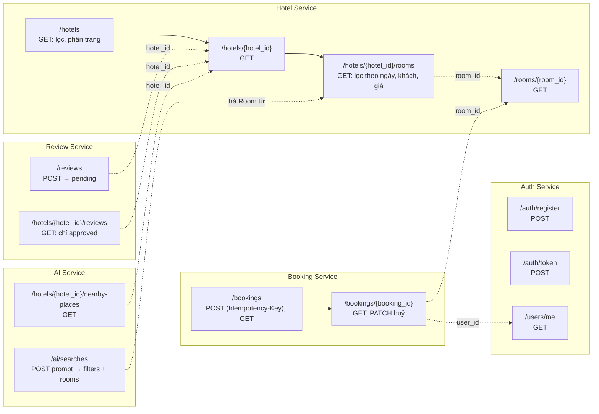

# HotelGenie — Resource model (API)

**Nguồn:** `docs/contracts/openapi-public.yaml` v1.0, `docs/03-SAD.md` mục 3–4, `docs/05-data-design.md` mục 8.

Resource model mô tả những gì **client nhìn thấy qua API**, khác với database schema (`docs/diagrams/05-er-diagram.mmd`). Mỗi resource thuộc đúng một service; quan hệ giữa các service chỉ qua ID, không qua khoá ngoại.

## 1. Sơ đồ resource và URL

Mũi tên liền: quan hệ cha – con trong cùng service. Mũi tên đứt: tham chiếu bằng ID sang resource của service khác.

## 2. Danh sách resource

| Resource | URL | Service sở hữu | Kiểu | Ghi chú |
| --- | --- | --- | --- | --- |
| User | `/users/me` | Auth | singleton | Lấy từ JWT, không nhận `user_id` từ client |
| Token | `/auth/token` | Auth | workflow resource | Đăng nhập, trả JWT |
| Hotel | `/hotels`, `/hotels/{hotel_id}` | Hotel | collection, item | Resource gốc |
| Room | `/hotels/{hotel_id}/rooms`, `/rooms/{room_id}` | Hotel | sub-collection, item | Room là phòng vật lý (ADR-01) |
| Booking | `/bookings`, `/bookings/{booking_id}` | Booking | collection, item | Chỉ thấy booking của mình; huỷ bằng `PATCH status=cancelled` |
| Review | `/reviews`, `/hotels/{hotel_id}/reviews` | Review | collection, sub-collection | Tạo ở cấp gốc, đọc theo khách sạn; chỉ hiện `approved` |
| AI search | `/ai/searches` | AI | workflow resource | Không lưu; phòng luôn lấy từ Hotel Service |
| Nearby place | `/hotels/{hotel_id}/nearby-places` | AI | sub-collection (tính toán) | `source`, `is_fallback`; Gateway route sang AI Service |

## 3. Quy tắc đặt tên

- Tiền tố `/api/v1`; danh từ số nhiều, chữ thường, kebab-case trong URL (`nearby-places`); snake_case trong JSON (`price_per_night_vnd`).
- ID là UUID; tiền là số nguyên VND; ngày `YYYY-MM-DD`, khoảng ở `[check_in, check_out)`.
- Sub-resource tối đa 1 cấp dưới `/hotels/{hotel_id}`.
- Thao tác không ánh xạ được thành bản ghi lưu trữ (`auth/token`, `ai/searches`) dùng danh từ của quy trình, phương thức `POST`.

## 4. Vì sao `/reviews` tạo ở cấp gốc nhưng đọc dưới `/hotels/{hotel_id}/reviews`

Tạo review gửi `hotel_id` trong body để Review Service tự kiểm tra và Gateway route đơn giản theo tiền tố `/reviews`. Đọc review đặt dưới khách sạn vì client luôn xem review theo một khách sạn. Đổi lại, cùng một resource có hai URL; Gateway phải route `/hotels/{hotel_id}/reviews` sang Review Service chứ không phải Hotel Service (04-api-events mục 3).
