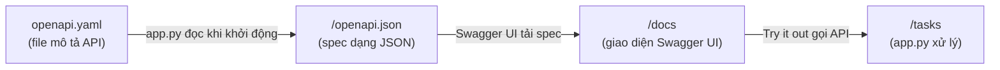
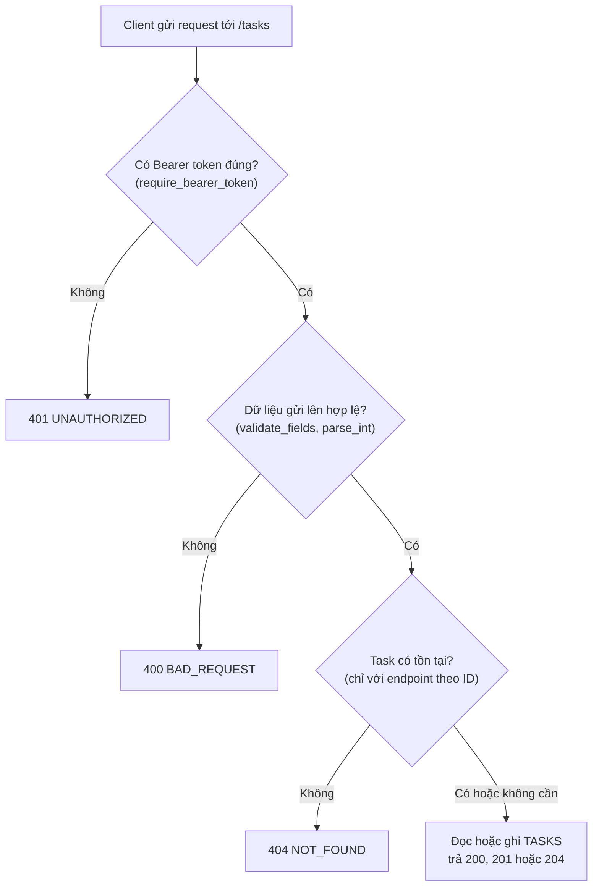

Nhóm 8 - INT3505E 2:

| Mã sinh viên | Họ và tên |
|---|---|
| 21021503 | Nguyễn Phan Hùng |
| 24021485 | Lã Việt Hoàng |

Tasks API quản lý danh sách công việc với 5 endpoint. Hai file này phối hợp với nhau:
`openapi.yaml` **mô tả** API, còn `app.py` **chạy** API đó. `app.py` đọc `openapi.yaml` để phục vụ tài liệu,
nên spec chỉ được viết ở một nơi.

## 1. `openapi.yaml`: bản mô tả API (OpenAPI 3.1.0)

| Phần | Nội dung |
|---|---|
| `info` | Tên API, mô tả, phiên bản, tên nhóm và email liên hệ, giấy phép MIT. |
| `servers` | `url: /` là địa chỉ tương đối, nên Try it out luôn gọi đúng server đang chạy `/docs`. |
| `tags` | Nhóm `tasks` để Swagger UI gom 5 endpoint vào một mục. |
| `security` | Áp dụng `bearerAuth` cho toàn bộ API. |
| `paths` | Các endpoint, xem bảng bên dưới. |
| `components` | Phần dùng lại bằng `$ref`: `schemas`, `responses`, `securitySchemes`. |

### Các endpoint trong `paths`

| Method | Path | operationId | Chức năng | Mã trả về |
|---|---|---|---|---|
| GET | `/tasks` | `listTasks` | Liệt kê, lọc theo `status`, phân trang `limit`/`offset` | 200, 400, 401 |
| POST | `/tasks` | `createTask` | Tạo task mới | 201, 400, 401 |
| GET | `/tasks/{taskId}` | `getTask` | Xem một task | 200, 401, 404 |
| PATCH | `/tasks/{taskId}` | `updateTask` | Cập nhật một phần | 200, 400, 401, 404 |
| DELETE | `/tasks/{taskId}` | `deleteTask` | Xóa task | 204, 401, 404 |

Mỗi `operationId` là duy nhất để công cụ sinh SDK đặt tên hàm. Tham số `taskId` được khai báo một lần ở cấp path
`/tasks/{taskId}` rồi dùng chung cho GET, PATCH, DELETE.

### Các schema trong `components`

- `Task`: task trả về, có `id` (uuid) và `createdAt` do server sinh.
- `TaskCreate`: dữ liệu khi tạo, bắt buộc `title`, `status` mặc định `todo`.
- `TaskUpdate`: dữ liệu khi cập nhật, mọi trường tùy chọn nhưng phải có ít nhất một (`minProperties: 1`).
- `TaskStatus`: kiểu liệt kê `todo`, `in_progress`, `done`, dùng lại ở nhiều nơi.
- `TaskList`: kết quả danh sách, gồm `items` và `total`.
- `Error`: định dạng lỗi chung `{ "code": "...", "message": "..." }`.

Hai schema đầu vào có `additionalProperties: false`, nên gửi trường lạ như `id` sẽ bị từ chối.

### Response dùng chung và bảo mật

- `BadRequest` (400), `NotFound` (404), `Unauthorized` (401), `UnexpectedError` (default) đều dùng schema `Error`.
- `bearerAuth` là xác thực HTTP Bearer. Swagger UI hiện nút Authorize dựa vào khai báo này.
- Ví dụ trong file dùng `examples` (không dùng `example` đã bị deprecated ở OpenAPI 3.1) nên không có cảnh báo.

## 2. `app.py`: ứng dụng Flask chạy API

| Thành phần | Vai trò |
|---|---|
| `SPEC` | Đọc `openapi.yaml` thành dict khi khởi động. |
| `TASKS` | Dict lưu task trong bộ nhớ (mất dữ liệu khi khởi động lại server). |
| `API_TOKEN` | Token demo, mặc định `demo-token`, đổi được bằng biến môi trường `TASKS_API_TOKEN`. |
| `ApiError` và các `errorhandler` | Mọi lỗi (400, 401, 404, 405, 500) đều trả JSON đúng schema `Error`, kể cả đường dẫn không tồn tại. |
| `require_bearer_token` | Chạy trước mỗi request tới `/tasks`. Thiếu hoặc sai token thì trả 401 kèm `WWW-Authenticate: Bearer`. |
| `validate_fields` | Kiểm tra dữ liệu gửi lên: độ dài `title`, giá trị `status`, định dạng `dueDate`, trường lạ. |
| `parse_int` | Kiểm tra `limit` (1-100) và `offset` (từ 0). |
| `list_tasks`, `create_task`, `get_task`, `update_task`, `delete_task` | 5 hàm xử lý tương ứng 5 endpoint trong spec. |
| `/openapi.json` | Trả `SPEC` dạng JSON để công cụ khác đọc. |
| `/docs` | Trang HTML nạp Swagger UI từ CDN rồi đọc `/openapi.json`, có Try it out. |

### Luồng một request

Mọi lỗi trong sơ đồ (401, 400, 404) đều trả JSON dạng `Error` nhờ các `errorhandler`.

`/docs` và `/openapi.json` không cần token để ai cũng xem được tài liệu. Chỉ các đường dẫn bắt đầu bằng `/tasks` mới bị kiểm tra.

## 3. Hai file khớp với nhau ở đâu

| Trong `openapi.yaml` | Trong `app.py` |
|---|---|
| `status` chỉ nhận `todo`, `in_progress`, `done` | `STATUSES` và `validate_fields` kiểm tra đúng ba giá trị này |
| `limit` từ 1 đến 100, mặc định 20 | `parse_int("limit", 20, 1, 100)` |
| `title` dài 1 đến 200 ký tự | `validate_fields` báo 400 nếu ngoài khoảng |
| `additionalProperties: false` | `validate_fields` báo 400 khi có trường lạ |
| Response 201 có header `Location` | `create_task` gắn `Location: /tasks/{id}` |
| Response 204 không có nội dung | `delete_task` trả `Response(status=204)` |
| Response 401 và `bearerAuth` | `require_bearer_token` |
| Response lỗi dùng schema `Error` | các `errorhandler` trả `{code, message}` |

Khi sửa hành vi của API, cần sửa cả hai file để spec không nói sai về code.
